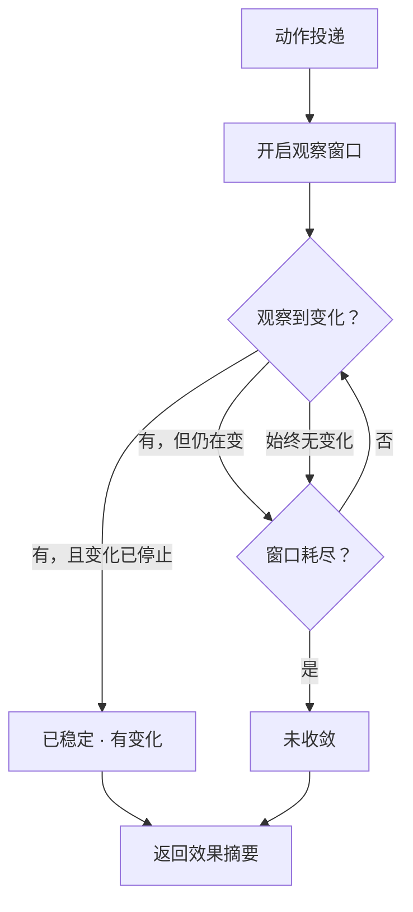

# 动作收敛与等待

动作执行后，SCU 如何判断目标是否已进入稳定状态。设计理由见
[ADR-0011](../decisions/adr_0011_convergence_over_fixed_delay.md)，
效果摘要的字段定义见[协议总览](../interfaces/protocol_overview.md)。

## 导航

- [要解决的问题](#要解决的问题)
- [收敛窗口](#收敛窗口)
- [稳定信号](#稳定信号)
- [判定结果](#判定结果)
- [显式等待](#显式等待)
- [局限](#局限)

## 要解决的问题

判断"动作是否生效"必须在一个确定的时刻做。这个时刻的选择是两难：

- **判断太早**：界面还在变化，得到"无变化"的结论，误报为空操作
- **判断太晚**：浪费时间，且对快速应用而言等待毫无意义

固定延时无法解决这个两难，因为它对"需要多久"这件事一无所知。
一个 300ms 完成的界面切换与一个 3 秒的列表加载，用同一个延时常量处理，
必然有一边是错的。

## 收敛窗口

SCU 在每次动作后开启一个有界观察窗口：

窗口有两个边界：

- **静默阈值**：持续多久无变化视为稳定。取值需要足够长以跨过
  单帧渲染抖动，足够短以不让用户等待
- **总上限**：窗口的最长时长。超过即返回"未收敛"，不继续等待

两个阈值都是启发式的，具体取值待实验确定。

### P0 实际（已实现，启发式初值）

P0 没有变更通知，也没有显式等待原语；点击之后用**轮询重读**近似：

| 项 | 取值 |
| --- | --- |
| 轮询间隔 | 200 毫秒 |
| 收敛条件 | 连续两次重读的结构摘要一致，**且这次读取未被截断** |
| 总上限 | 3 秒的**时钟**上限，在每次重读完成之后检查（单次重读受 `budget_ms` 约束，大树上可能远超 3 秒） |
| 结果 | `converged` / `treeChanged` / `targetChanged` / `noOpSuspected`；被截断时为 `unknown`，见 [MCP 接入面](../interfaces/mcp_surface.md#click_tool) |

已知缺口：两次一致只说明 400 毫秒内没变，不说明加载已结束；夹具上两秒后才变化的场景被判为已收敛。
记录见 [ADR-0011 追加记录](../decisions/adr_0011_convergence_over_fixed_delay.md) 与
[夹具验证](../../verification/2026-10-18-fixture-validation.md)。下文关于变更通知与显式等待的描述是**未实现的设计**。

## 稳定信号

判定"变化已停止"依赖可观测信号，按可靠性排序：

| 信号 | 可靠性 | 说明 |
| --- | --- | --- |
| 无障碍树变更通知停止 | 高 | 平台提供，不依赖轮询 |
| 明确的加载状态结束 | 高 | 应用声明了忙碌或进度状态时 |
| 树内容比对无差异 | 中 | 需要主动读取两次树 |
| 窗口尺寸与位置稳定 | 低 | 只覆盖几何变化，漏掉内容变化 |

首选变更通知，因为它不需要轮询，且能覆盖树的一切变化。
轮询比对是兜底——某些平台或某些应用可能不发出通知。

**不使用像素比对。** 光标闪烁、时钟、动画都会造成像素变化，
把它当信号会持续误判为"仍在变化"。

## 判定结果

动作的效果摘要中，"是否收敛"与"是否变化"是**两个独立的维度**：

| 收敛 | 有变化 | 含义 | 调用方应做 |
| --- | --- | --- | --- |
| 是 | 是 | 动作生效 | 继续，读取新状态 |
| 是 | 否 | 疑似空操作 | 检查元素是否可交互，考虑换方式 |
| 否 | 任意 | 结果未知 | 显式等待后重读，或放弃 |

第三行是关键的改进：**"未收敛"不是"没生效"，而是"还不知道"。**
把这两种情况合并会误导调用方做出错误判断——要么过早放弃，
要么把仍在进行的操作当作失败而重复执行。

## 显式等待

除了动作内置的收敛窗口，另有独立的等待原语。

用途是在调用方**已知**需要等待时避免重复的动作级开销。
典型场景：点击了一个触发网络请求的按钮，调用方知道要等几百毫秒，
比让每次动作都跑完整的收敛窗口更省。

等待原语的语义是"等待目标进入稳定状态"，参数是上限时长，而非固定延时。
即：一旦观测到稳定就提前返回，不会真的等待满整个时长。

**等待原语不产生效果摘要。** 它只回答"稳定了没有"，
不回答"期间发生了什么"——那是后续的状态读取的职责。

## 局限

- **无信号的等待**：目标应用的忙碌状态不可观测时，判定退化为固定超时
- **持续动画**：界面有无限循环动画（进度指示、光标闪烁）时，
  "变化停止"永不成立，只能靠总上限兜底
- **后台任务**：动作触发了一个不改变界面、但占用数秒的后台任务时，
  收敛判定会立即返回"已稳定无变化"，与真实情况不符

最后一条无法在 UI 层解决——界面确实是稳定的，只是后台在做别的事。
调用方需要理解这一点，不能把"无变化"直接等同于"无需继续等待"。
