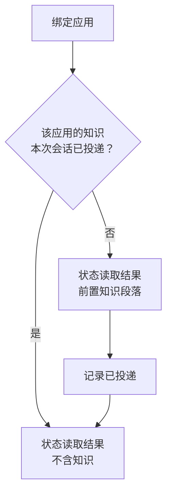

# 按应用知识注入

SCU 如何利用针对特定应用的先验知识提升操作成功率。

## 外部观察来源

本文涉及对两套已发布实现的观察结论。来源、具体证据与复核方法见
[verification/external-sources.md](../../verification/external-sources.md)。

## 导航

- [动机](#动机)
- [知识形态](#知识形态)
- [投递时机](#投递时机)
- [内容边界](#内容边界)
- [局限](#局限)

## 动机

无障碍树描述了界面的**结构**，但不描述**行为**。以下这类事实无法从树里读出来：

- 某个应用在请求播放后不会立即更新界面，过早重试会导致状态回退
- 某个应用的搜索框需要先获得焦点再回车，否则回车会触发别的功能
- 某个应用的关键操作依赖网络响应，失败时的表现是"无结果"而不是错误

这些都是**踩过坑才知道的事**。模型在没有这些知识时会重现同样的错误，
而且失败往往是静默的。

参考实现中观察到一种做法：为少数应用维护独立的说明文档，
在首次访问该应用时投递给模型。观察到的实现只维护了极少数几个应用，
而绝大多数应用（包括常见的音乐、聊天类应用）并不在覆盖范围内。

## 知识形态

知识是**自由文本**，不是结构化规则。

理由：这些知识的本质是"注意事项"和"经验"，不是可以机械执行的规则。
强行结构化会损失表达力，而模型本身就是处理自然语言的。

知识的边界应当是：**关于这个应用的行为特征，而不是关于某个具体任务的操作步骤。**
任务步骤属于调用方的职责，不属于 SCU。

反例（不应写入）：如何搜索一首歌。
正例（应当写入）：该应用的搜索结果列表在刷新前会短暂显示为空。

## 投递时机

知识在**首次绑定该应用时**投递，随该次状态读取的结果一同返回。

投递**每会话一次**，不是每次读取都投递。重复投递会持续占用上下文，
而知识在会话内不会变化。

会话重置后需要重新投递——重置意味着上下文已清空。

判断"是否已投递"需要按应用标识跟踪，且跟踪状态属于会话（不持久化）。

## 内容边界

知识文档的内容必须满足：

- **不包含凭据、令牌、账户标识**等敏感信息
- **不包含用户特定内容**（用户名、联系人、历史记录）
- **不描述绕过安全机制的步骤**
- **不包含具体任务的完整操作序列**

最后一条的原因：把任务步骤写进应用知识，会让知识库变成一份
隐式的自动化脚本库，而脚本会随应用更新而失效，且失效时不会有人发现。

知识应当**只描述不变的行为特征**。应用的行为特征比界面布局稳定得多。

## 局限

- **覆盖范围有限**：只为少数高频应用维护知识，其余应用没有。
  这是有意的——为每个应用维护知识不可能持续。
- **知识会过时**：应用更新后行为可能改变，而知识不会自动失效。
  需要人工复核机制，或者接受一定程度的不准确。
- **投递是单向的**：SCU 不会从操作失败中自动学习新知识。
  填这个空需要另一套机制（观察失败并生成候选知识），当前不在范围内。
