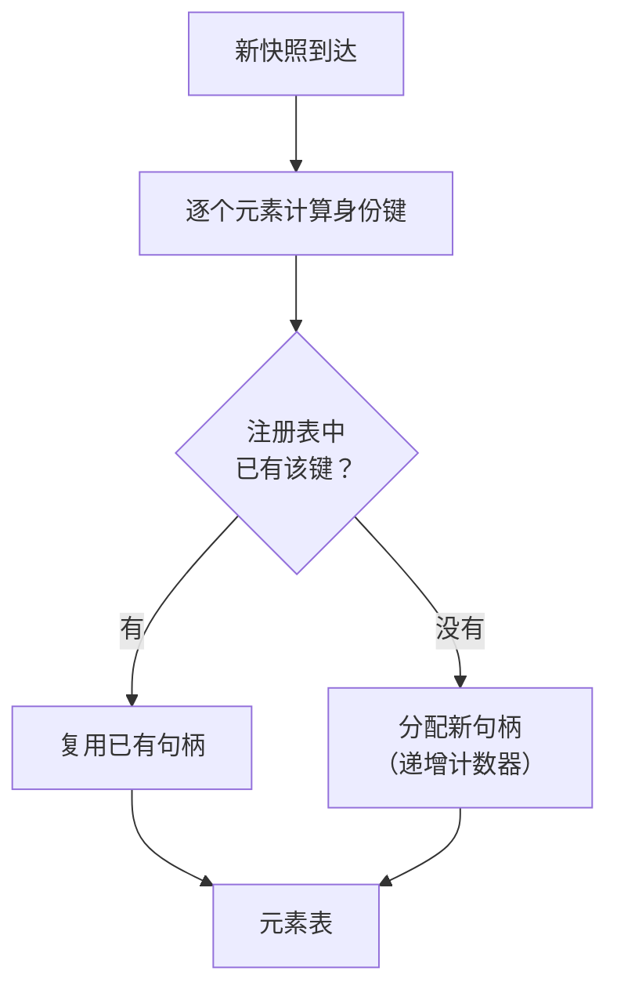

# 元素身份

本文描述 SCU 如何在无障碍树变化后仍然识别出"同一个元素"。这是 SCU 相对
既有实现的核心差异点。不覆盖快照与令牌的状态迁移
（见[快照生命周期](snapshot_lifecycle.md)），设计理由见
[ADR-0004](../decisions/adr_0004_stable_element_identity.md)。

## 导航

- [问题](#问题)
- [两个必须分开的概念](#两个必须分开的概念)
- [结构化身份键](#结构化身份键)
- [句柄注册表](#句柄注册表)
- [匹配算法](#匹配算法)
- [匹配结果](#匹配结果)
- [与快照的关系](#与快照的关系)
- [已知限制](#已知限制)
- [待验证项](#待验证项)

## 问题

既有实现用**位置**寻址元素：读一次无障碍树，给每个元素分配一个序号，
后续动作引用这个序号。

序号只在产生它的那一次读取中有效。任何界面变化——列表刷新、弹窗打开、
一个元素被插入到前面——都会让序号整体错位。调用方必须每次动作后重新读取，
而且必须先知道自己手上的引用已经失效。

问题在于**失效是静默的**：序号 42 仍然存在，只是指向了别的控件。

## 两个必须分开的概念

一个朴素的想法是"用内容的哈希作身份"。这会把两件不同的事混在一起，
各自都做不好：

| 需求 | 好的性质 | 哈希方案的问题 |
| --- | --- | --- |
| **快照内引用**：调用方在本次快照里指向某个元素 | 短、唯一、零碰撞 | 4 位哈希有 6.5 万取值，数百元素时碰撞概率极高 → 歧义常态化 |
| **跨快照身份**：界面变化后找回同一个元素 | 稳定、可按字段降级比较 | 单一哈希不可拆解，无法表达"identifier 相同但 title 变了" |

因此 SCU 把它们拆开：

- **快照内引用**用**句柄**——会话内递增计数器，保证唯一，长度可控
- **跨快照身份**用**结构化身份键**——多级字段组合，逐级降级比较

## 结构化身份键

身份键由三级组成，按稳定性从高到低：

| 层级 | 组成 | 稳定性 | 说明 |
| --- | --- | --- | --- |
| **L1** | `identifier` | 最高 | 应用显式设置的稳定标识 |
| **L2** | `role` + `subrole` + `title` + **祖先 role 路径** | 高 | 不依赖任何同级序号 |
| **L3** | L2 + 同级序号 | 中 | 前两级都失败时的兜底 |

### 祖先 role 路径不含同级序号

这是整个算法的关键设计。

反面设计（**已否决**）是把同级序号放进路径。那样会得到：

```
插入前： Window/List/[Row:0]/TextField
插入一个 Row 到前面之后：
        Window/List/[Row:1]/TextField   ← 序号变了
        并且其后所有 Row 的序号全部后移
```

一个元素的插入会让**其后所有元素**的身份失效——这正好抵消了内容寻址的目标。
在最需要这个机制的场景（列表刷新）里，方案会退化成"重新读取整树"。

采用的设计只记录 role 序列：

```
Window/List/Row/TextField
```

插入兄弟节点不会改变任何后代节点的这条路径。代价是**路径的区分力下降**：
同一层级若有多个同 role 的兄弟，L2 无法区分它们——这时交给 L3。

### 字段的取舍

- `title` 进 L2，但它是三个字段里最易变的。正在播放的歌曲名、进度百分比、
  未读计数都会持续变化。**易变字段的识别与排除规则待验证阶段确定**
  （见[测试策略](../operations/testing.md)）。
- 几何信息（位置、尺寸）**不进身份键**。窗口缩放不应改变身份。
- `value` **不进身份键**。输入框的内容变化不代表换了元素。

## 句柄注册表

身份键是复合结构，不适合直接作为对外的引用。对外暴露的是**句柄**。

会话内维护一张注册表：



关键性质：

- **句柄是计数器，不是哈希。** 同一会话内绝无碰撞，长度随元素总数增长但很慢
- **同一元素跨快照保持同一句柄**，因为匹配走的是身份键
- **注册表是会话级的**，会话结束即丢弃。句柄不跨会话使用
- 未匹配上的元素视为新元素，分配新句柄；上一轮有、这一轮没有的元素，
  其句柄变为**已消失**状态

注册表本身是协议层的状态。它不进入原生层，也不需要持久化。

## 匹配算法

给定一个身份键与一个新快照，按层级顺序尝试：

1. **L1 匹配**：存在元素的 `identifier` 与键相等 → 命中，标记 `stable`
2. **L2 匹配**：`role` + `subrole` + 祖先 role 路径相等，且 `title` 相等 → 命中 `stable`；
   若仅 `title` 不同而其余相等 → 命中 `changed`
3. **L3 匹配**：在 L2 命中的候选集中，用同级序号唯一确定 → 命中 `inferred`
4. **未命中**：报告 `missing`
5. **多个同等候选**：报告 `ambiguous`，不任选

**每一步都是字段比较，不是哈希比较。** 这是"结构化键"相对"内容哈希"的
根本收益：可以表达"部分字段变了"这种中间状态。

### 为什么 L3 只作兜底

L3 依赖同级序号，因此继承了位置寻址的全部弱点。把它放在最后一级，
并且只在 L1、L2 都无法区分时使用，是为了让**最常见的情况不被最脆弱的手段拖累**。

## 匹配结果

| 状态 | 含义 | 调用方可做 |
| --- | --- | --- |
| `stable` | 身份与属性都一致 | 直接使用 |
| `changed` | 身份一致，属性有变化 | 使用，并可感知变化 |
| `inferred` | 靠同级序号推断命中 | 使用，但动作后建议核对效果 |
| `missing` | 未找到 | 重新读取状态，或向用户求助 |
| `ambiguous` | 多个候选 | 必须重新读取状态 |

`inferred` 与 `ambiguous` 的区分是刻意的：前者是"大概率对"，后者是"无法判断"。

## 与快照的关系

元素身份**不单独使用**，它与快照版本绑定：

- 快照未变（令牌有效）→ 句柄直接按位置解析，零成本
- 快照已变（令牌失效）→ 用身份键在新快照中重新匹配，句柄不变

界面稳定时零成本，界面变化时可恢复。两者的配合见
[快照生命周期](snapshot_lifecycle.md)。

## 已知限制

- **同 role 的兄弟节点**：L2 无法区分，只能靠 L3 的序号或 `title`。
  这类元素在列表重排序时仍会失效。
- **动态内容**：频繁变化的 `title`（时间戳、进度、未读计数）会持续污染 L2。
  需要把易变字段排除在身份键外，但识别规则未定。
- **虚拟化列表**：只渲染可见行的列表（常见于 Electron 应用）会让
  未显示的元素根本无法寻址。
- **跨会话不可用**：句柄是会话级的。若将来要支持跨会话的元素记忆，
  需要用身份键而不是句柄作为持久标识。

以上限制是设计上的已知缺口，不打算在首版解决。

## 待验证项

整套方案建立在"真实应用的无障碍树提供足够稳定的字段"这一假设上，
**该假设尚未验证**。验证方法与通过标准见
[测试策略](../operations/testing.md)。

具体要回答的问题：

1. 原生应用设置 `AXIdentifier` 的比例有多高？如果普遍不设，L1 形同虚设，
   匹配主要靠 L2。
2. L2 的祖先 role 路径在实际应用中区分力如何？同 role 兄弟节点是否常见？
3. `title` 的易变程度如何？哪些应用会在 `title` 里放动态内容？
4. `AXObserver` 的通知是否可靠、延迟多少？（同时决定令牌判定机制）

若第 1 项的覆盖率过低，L2 的稳定性成为瓶颈，届时需要重新评估
[ADR-0004](../decisions/adr_0004_stable_element_identity.md)。
