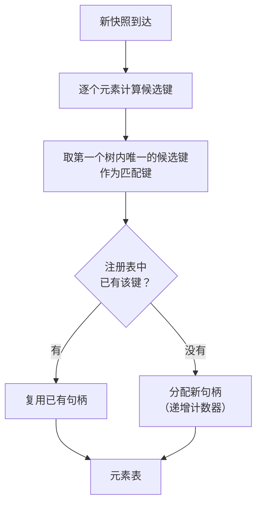

# 元素身份

本文描述 SCU 如何在无障碍树变化后仍然识别出"同一个元素"。这是 SCU 相对
既有实现的核心差异点。不覆盖快照与令牌的状态迁移
（见[快照生命周期](snapshot_lifecycle.md)），设计理由见
[ADR-0004](../decisions/adr_0004_stable_element_identity.md)。

## 导航

- [问题](#问题)、[两个必须分开的概念](#两个必须分开的概念)：为什么不能用一个哈希
- [候选键与匹配键](#候选键与匹配键)：K1~K4 的定义与取键规则
- [句柄注册表](#句柄注册表)、[匹配算法](#匹配算法)：跨快照延续的机制
- [与快照的关系](#与快照的关系)、[已知限制](#已知限制)、[待验证项](#待验证项)

## 问题

既有实现用**位置**寻址元素：读一次无障碍树，给每个元素分配一个序号，
后续动作引用这个序号。

序号只在产生它的那一次读取中有效。任何界面变化——列表刷新、弹窗打开、
一个元素被插入到前面——都会让序号整体错位。调用方必须每次动作后重新读取，
而且必须先知道自己手上的引用已经失效。

问题在于**失效是静默的**：序号 42 仍然存在，只是指向了别的控件。

## 两个必须分开的概念

一个朴素的想法是"用内容的哈希作身份"。这会把两件不同的事混在一起，
各自都做不好：

| 需求 | 好的性质 | 哈希方案的问题 |
| --- | --- | --- |
| **快照内引用**：调用方在本次快照里指向某个元素 | 短、唯一、零碰撞 | 4 位哈希有 6.5 万取值，数百元素时碰撞概率极高 → 歧义常态化 |
| **跨快照身份**：界面变化后找回同一个元素 | 稳定、可按字段降级比较 | 单一哈希不可拆解，无法表达"identifier 相同但 title 变了" |

因此 SCU 把它们拆开：

- **快照内引用**用**句柄**——会话内递增计数器，保证唯一，长度可控
- **跨快照身份**用**结构化身份键**——多级字段组合，逐级降级比较

## 候选键与匹配键

对每个元素，按优先级计算**四个候选键**：

| 优先级 | 组成 | 稳定性 | 进键的字段 |
| --- | --- | --- | --- |
| **K1** | `identifier` | 最高 | 应用显式设置的稳定标识 |
| **K2** | `role` + `subrole` + `title` + 祖先 role 路径 | 高 | 含 title，区分力最强 |
| **K3** | `role` + `subrole` + 祖先 role 路径 | 中 | 不含 title，抗 title 抖动 |
| **K4** | K3 + **同级序号** | 低 | 必然唯一，但随兄弟增删失效 |

**匹配键 = 第一个在整棵树中唯一的候选键。**

之所以要"唯一"这一条：注册表以匹配键为键，若两个元素共用一个键，
它们会拿到同一个句柄——这是不可接受的。K4 含同级序号，
同级内序号互不相同，因此**一定存在一个唯一可用的键**。

### 为什么 title 只出现在 K2

`title` 的区分力最强，也最容易变（正在播放的歌名、未读计数）。
若把含 title 的键设为唯一候选，就会二选一：要么牺牲区分力，要么牺牲稳定性。

放进候选列表就不必选：**title 稳定时命中 K2（区分力强），
title 抖动时自动落到 K3（稳定性强）。** 两种性质由优先级顺序同时获得。

### 祖先 role 路径不含同级序号

这是整个算法的关键设计。

反面设计（**已否决**）是把同级序号放进路径。那样会得到：

```
插入前： Window/List/[Row:0]/TextField
插入一个 Row 到前面之后：
        Window/List/[Row:1]/TextField   ← 序号变了
        并且其后所有 Row 的序号全部后移
```

一个元素的插入会让**其后所有元素**的身份失效——这正好抵消了内容寻址的目标。
在最需要这个机制的场景（列表刷新）里，方案会退化成"重新读取整树"。

采用的设计只记录 role 序列：

```
Window/List/Row/TextField
```

插入兄弟节点不会改变任何后代节点的这条路径。代价是**路径的区分力下降**：
同一层级若有多个同 role 的兄弟，L2 无法区分它们——这时交给 L3。

### 字段的取舍

- `title` 进 L2，但它是三个字段里最易变的。正在播放的歌曲名、进度百分比、
  未读计数都会持续变化。**易变字段的识别与排除规则待验证阶段确定**
  （见[测试策略](../operations/testing.md)）。
- 几何信息（位置、尺寸）**不进身份键**。窗口缩放不应改变身份。
- `value` **不进身份键**。输入框的内容变化不代表换了元素。

## 句柄注册表

匹配键是复合结构，不适合直接作为对外的引用。对外暴露的是**句柄**。

会话内维护一张注册表，**以匹配键为键**：



关键性质：

- **句柄是计数器，不是哈希。** 同一会话内绝无碰撞
- **注册表以匹配键为键，而匹配键保证树内唯一。**
  两个 K2 相同的兄弟元素不会共用一个句柄——它们的匹配键在 K4 上不同
- **注册表是会话级的**，会话结束即丢弃。句柄不跨会话使用
- 上一轮有、这一轮没有的元素，其句柄变为**已消失**状态

注册表本身是协议层的状态。它不进入原生层，也不需要持久化。

## 匹配算法

跨快照匹配就是**注册表查找**，没有独立的一步：

1. 新快照到达，为每个元素计算候选键并定出匹配键
2. 匹配键在注册表中存在 → 复用句柄；不存在 → 分配新句柄
3. 注册表中存在但本快照未出现的键 → 对应句柄转为**已消失**

### 匹配结果的判定

复用句柄时，比较该元素的 `title` 与 `value` 与注册时记录的值：

| 情况 | 状态 |
| --- | --- |
| 匹配键为 K4 | `inferred`（依赖同级序号，可靠性低） |
| 匹配键为 K1/K2/K3，且 `title` 与 `value` 都没变 | `stable` |
| 匹配键为 K1/K2/K3，但 `title` 或 `value` 变了 | `changed` |
| 匹配键在本快照中不存在 | `missing` |

### 为什么没有 `ambiguous`

前几版设计有一个 `ambiguous`（多候选，拒绝选择）状态，它源于
**单一哈希不可拆解**：哈希碰撞时无从判断，只能拒绝。

改成候选键列表后，歧义在结构上被消除了：K4 含同级序号，
一定唯一，因此总能定出一个匹配键。

**代价是"宁可拒绝也不猜"这条原则被弱化**——K4 本质上是在用位置猜。
设计上的补偿是**用 `inferred` 状态显式标注这种猜测**：
调用方能看到当前匹配建立在同级序号上，因而可靠性较低。

这不是把猜测藏起来，而是把它标出来。

## 与快照的关系

元素身份**不单独使用**，它与快照版本绑定：

- 快照未变（令牌有效）→ 句柄直接按位置解析，零成本
- 快照已变（令牌失效）→ 用身份键在新快照中重新匹配，句柄不变

界面稳定时零成本，界面变化时可恢复。两者的配合见
[快照生命周期](snapshot_lifecycle.md)。

## 已知限制

- **同 role 的同级节点**：K2、K3 都无法区分，落到 K4 的同级序号。
  这类元素在列表重排序时句柄失效。`title` 有区分力时不会落到这一级，
  因此实际影响面取决于应用是否给同类控件设置了不同标题。
- **匹配键的层级会漂移**：某元素在快照 1 中 K2 唯一，快照 2 中新增了一个
  K2 相同的兄弟，于是它落到 K4——匹配键变了，注册表查不到，
  **句柄不延续**（旧句柄变"已消失"，元素拿新句柄）。
  这是当前设计的已知代价。要消除它需要让注册表同时索引多个候选键，
  并解决"多个元素认领同一个键"的竞争，复杂度显著上升，首版不做。
- **虚拟化列表**：只渲染可见行的列表（常见于 Electron 应用）会让
  未显示的元素根本无法寻址。
- **跨会话不可用**：句柄是会话级的。若将来要支持跨会话的元素记忆，
  需要用身份键而不是句柄作为持久标识。

以上限制是设计上的已知缺口，不打算在首版解决。

## 待验证项

整套方案建立在"真实应用的无障碍树提供足够稳定的字段"这一假设上，
**该假设尚未验证**。验证方法与通过标准见
[测试策略](../operations/testing.md)。

具体要回答的问题：

1. 原生应用设置 `AXIdentifier` 的比例有多高？如果普遍不设，L1 形同虚设，
   匹配主要靠 L2。
2. L2 的祖先 role 路径在实际应用中区分力如何？同 role 兄弟节点是否常见？
3. `title` 的易变程度如何？哪些应用会在 `title` 里放动态内容？
4. `AXObserver` 的通知是否可靠、延迟多少？（同时决定令牌判定机制）

若第 1 项的覆盖率过低，L2 的稳定性成为瓶颈，届时需要重新评估
[ADR-0004](../decisions/adr_0004_stable_element_identity.md)。
