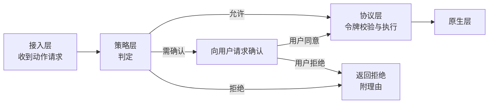

# 策略与审批

SCU 如何决定一个动作是否允许执行。设计理由见
[ADR-0009](../decisions/adr_0009_policy_layer.md)，范围边界见
[ADR-0010](../decisions/adr_0010_ui_automation_only.md)。

## 导航

- [位置](#位置)
- [判定输入](#判定输入)
- [三态结论](#三态结论)
- [审批状态与作用域](#审批状态与作用域)
- [拒绝类目](#拒绝类目)
- [与协议层的分工](#与协议层的分工)

## 位置

策略层位于接入层与协议层之间。**每个动作都必须经过它**，
没有旁路。

策略层**不持有快照状态**，因此它可以在协议层之前判定：
被策略拒绝的动作不会触达协议层，也不会消耗令牌。

## 判定输入

策略判定需要的信息，全部来自动作请求本身：

| 输入 | 用途 |
| --- | --- |
| 动作类型 | 点击、输入、按键、滚动、拖拽、设值、次要动作、截图、读状态 |
| 目标应用标识 | 命中拒绝类目与逐应用审批 |
| 是否为坐标类动作 | 坐标类动作的盲操作风险高于元素类 |
| 目标是否为文本输入 | 判断是否涉及敏感数据输入 |
| 请求的来源会话 | 审批状态的作用域查询 |

策略层**不读取**动作的实际内容（例如将要输入的文本内容），
也不读取目标元素当前的值。理由是这两者都可能包含敏感数据，
让策略层接触它们会扩大敏感数据的暴露面。

代价是策略无法基于内容判断。例如"检测到正在输入信用卡号"这类规则
无法实现。这个限制是刻意接受的。

## 三态结论

| 结论 | 调用方应做 |
| --- | --- |
| 允许 | 无需额外处理，动作继续 |
| 需确认 | 向用户展示请求，等待决定；用户同意后动作方可执行 |
| 拒绝 | 不重试。这是策略性拒绝，重试不会有不同结果 |

**"需确认"与"拒绝"必须区分。** 前者是可恢复的——换个方式或者征得同意后继续；
后者是不可协商的。调用方若把两者混同，会在策略拒绝上无限重试。

拒绝的返回值需要携带**机器可读的理由类别**，而不是只有自然语言描述。
调用方至少需要区分：

- 命中拒绝类目（不可协商）
- 目标应用未被用户授权（可通过授权恢复）
- 动作类型需要逐次确认（可再次请求）

## 审批状态与作用域

审批结果按**两个作用域**记录：

| 作用域 | 生命周期 | 用途 |
| --- | --- | --- |
| 会话级 | 当前会话结束即失效 | 用户在本次任务中同意过的应用 |
| 持久级 | 跨会话保留，用户可撤销 | 用户长期信任的应用 |

判定顺序：先查会话级，命中则允许；再查持久级，命中则允许；
都未命中则返回"需确认"。

**持久级授权必须可由用户审计和撤销。** 用户在不知情的情况下
积累了长期授权是安全风险。需要提供查看当前授权列表的途径。

会话级授权存在的理由：一个任务往往需要连续操作同一个应用几十次。
每次都弹窗会让审批失去意义——用户会条件反射地点同意，
反而降低了安全性。会话级授权把审批次数降到应用粒度而非动作粒度。

## 拒绝类目

**不可协商的拒绝**，对应"绝不该发生的事"。这类判定不查询审批状态，
命中即拒绝，且不提供用户覆盖途径。

理由：这些操作的后果不可逆或超出用户能评估的范围。
一个被诱导的用户点了一次"同意"，不应该导致终端被接管。

类目设计（具体清单待实现时确定并随生态维护）：

| 类目 | 理由 |
| --- | --- |
| 运行命令行的应用 | 通过 UI 自动化操作终端等价于任意命令执行 |
| 运行脚本的应用 | 同上，且脚本可以进一步触发任意行为 |
| 持有密码凭据的应用 | 防止自动化被用于提取凭据 |
| 系统设置 | 修改系统级配置的影响面超出单个应用 |
| SCU 自身及其原生进程 | 防止自指操作导致状态不一致或自我提权 |

类目的识别依赖应用清单。清单需要版本化维护，
且应用标识应使用不可被轻易伪造的标识（bundle id 优于应用名）。

**类目之外的应用，一律通过审批而非硬编码拒绝。** 这个边界很重要：
硬编码清单的每一次扩大都在降低 SCU 的可用性，
所以它只应包含后果不可逆的情况。

## 与协议层的分工

两个层都可能拒绝一个动作，但拒绝的含义不同，**必须在返回值中可区分**：

| 层 | 拒绝原因 | 调用方应做 |
| --- | --- | --- |
| 策略层 | 不允许 / 未授权 | 不重试；需用户介入或换方式 |
| 协议层 | 令牌失效 / 引用歧义 / 目标不存在 | 重读状态后重试 |

如果两者返回同一种错误，调用方只能一律重试或一律放弃，
两种情况都会出错。这是接口设计上的硬要求。
