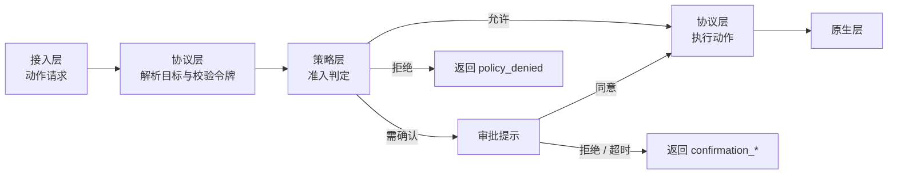

# 策略与审批

SCU 如何决定一个动作是否允许执行。设计理由见
[ADR-0009](../decisions/adr_0009_policy_layer.md)，范围边界见
[ADR-0010](../decisions/adr_0010_ui_automation_only.md)，
错误返回结构见[错误与拒绝](../interfaces/error_taxonomy.md)。

## 外部观察来源

本文涉及对两套已发布实现的观察结论。来源、具体证据与复核方法见
[verification/external-sources.md](../../verification/external-sources.md)。

## 导航

- [位置](#位置)
- [判定输入](#判定输入)
- [读与写的准入差异](#读与写的准入差异)
- [三态结论](#三态结论)
- [需确认的执行语义](#需确认的执行语义)
- [审批状态与作用域](#审批状态与作用域)
- [拒绝类目](#拒绝类目)
- [审批提示](#审批提示)
- [配置与审计](#配置与审计)

## 位置

策略层位于接入层与协议层之间，但**判定发生在协议层解析出目标之后**。

**为什么在目标解析之后**：策略判定的输入之一是目标应用的标识，
而动作请求里的元素引用（`AXTextField#t7`）**不含应用身份**——
目标只存在于会话的绑定状态中。判定必须等目标已经确定才能进行。

代价是被拒绝的动作已经过了一次令牌校验。这个代价可以接受：
令牌校验是一次版本号比较，不产生副作用。

**策略层仍然不持有状态。** 目标标识由协议层解析后作为参数传入，
策略层不读会话、不缓存任何东西。

## 判定输入

判定所需信息**全部作为参数传入**：

| 输入 | 来源 | 用途 |
| --- | --- | --- |
| 动作类型 | 动作请求 | 准入规则匹配 |
| 目标应用标识 | 协议层解析 | 命中拒绝类目与逐应用审批 |
| 引用形式 | 动作请求 | 区分元素寻址（精确）与坐标寻址（盲操作） |
| 是否为文本写入 | 动作类型推导 | 触碰敏感数据输入相关的规则 |
| 会话标识 | 动作请求上下文 | 查询会话级审批状态 |
| 执行模式 | 会话状态 | 接管模式下需要特殊处理（见下） |

策略层**不读取**动作的实际内容（例如将要输入的文本），
也不读取目标元素当前的值。理由是这两者都可能包含敏感数据，
让策略层接触它们会扩大敏感数据的暴露面。

代价是策略无法基于内容判断。例如"检测到正在输入信用卡号"这类规则无法实现。
这个限制是刻意接受的。

## 读与写的准入差异

**读操作不过准入，写操作逐次过准入。**

| 类别 | 包含 | 准入 | 理由 |
| --- | --- | --- | --- |
| 写 | 点击、输入、按键、滚动、拖拽、设值、次要动作 | 逐次判定 | 有副作用，可能不可逆 |
| 写 | 拖拽中的按住 / 释放、按住修饰键 | 归属包含它的动作 | 不单独判定，避免同一手势反复弹窗 |
| 读 | 读无障碍树、截图、列应用、列标签页 | 不判定 | 无副作用，且必须廉价 |
| 边界 | 绑定目标 | 授权关卡（见下） | 它是"能读哪些应用"的总闸 |

**绑定是授权的关口。** 读操作之所以可以不过准入，
是因为"能读哪个应用"已经在绑定时确定了：

- 绑定一个从未授权过的应用 → 弹出**授权提示**（见下文「授权的授予」）
- 已授权（会话级或持久级） → 绑定成功
- 之后在该目标内的读操作不再需要判定

这样既保证了读操作的廉价（探路阶段不需要反复弹窗），
又保证了用户对"agent 能读什么"的控制。

参考实现中也观察到同样的取向：应用枚举被明确标注为不需要权限与屏幕控制，
而动作类操作则按目标应用逐次决策。

## 三态结论

| 结论 | 调用方观察到的结果 | 说明 |
| --- | --- | --- |
| 允许 | 正常返回效果摘要 | 无需额外处理 |
| 需确认 | **阻塞**，直至用户作出决定 | 同意则正常返回；拒绝或超时返回错误码 |
| 拒绝 | `policy_denied` | **不重试。** 策略性拒绝，重试不会有不同结果 |

**"需确认"不产生一个专门的错误码。** 它是同步阻塞的，
调用方看到的是一个尚未 resolve 的 Promise，不需要为"等待用户"写分支。
只有当用户拒绝或超时，才会拿到错误码。

"需确认"与"拒绝"必须区分，且都必须在返回值上可区分于协议层的拒绝。
调用方若把三者混同，会对不可协商的拒绝无限重试，或者对可恢复的失效直接放弃。

> **当前实现（2026-10-20）**：下面的三态“需确认”仍是设计目标，尚未实现。
> 已实现的是[连接级应用允许列表](../decisions/adr_0024_app_authorization.md)：
> 一个 `scu mcp` 进程一个作用域，启动参数配置允许的应用；列表外应用在读取/动作前返回
> `app_not_authorized`。它不做运行时弹窗，也不提供模型可自调的授权工具。
> 参考实现的运行时审批也落在应用级，见[审批触发证据](../../verification/2026-10-20-approval-triggers.md)。

## 需确认的执行语义

这是三态中唯一需要等待活人的一态，语义必须明确定义。

### 同步阻塞

**动作请求同步等待用户的决定。** 调用方看到的是一个尚未 resolve 的 Promise。

选择同步而非异步回调的理由：调用方的代码是线性的（`await`），
异步回调会迫使它在动作之外维护状态机，而它此时并不掌握足够的信息
去决定"在等待期间还能做什么"。

### 超时与未决

确认请求有上限时长（具体取值待定）。超时后：

- 动作**未被执行**
- 返回 `confirmation_timeout`，`retry: after_user_action`
- 审批状态回到未决，用户可以稍后重新触发

**超时不等于拒绝。** 用户可以只是暂时不在电脑前。把超时当作拒绝并记录为
"用户拒绝过"，会导致后续的授权判断基于错误的事实。

**超时的 retry 不是 `immediate`。** 立即重试会重新弹出提示——
如果用户仍然不在，就是一次无效的弹窗循环。
它要求的是"用户回到电脑前"这个动作，而不是重试本身。
用户明确拒绝时返回 `confirmation_denied`，`retry: no`——不要重试。

### 接管显示模式下直接拒绝

**在接管显示模式下，需要确认的动作一律返回 `policy_denied`。**

这是为了避免死锁：接管显示模式下用户不能操作电脑，
而审批提示需要用户点击——两者互相等待。

拒绝是可接受的，因为接管模式本身就是"用户明确要求 agent 接管"的场景，
此时不应再要求逐次确认。需要细粒度确认的任务应当在后台模式下执行。

### 与串行队列的关系

**审批过程包含在串行段内**，不中断队列、不释放队列。

理由与[动作收敛](action_convergence.md)相同：审批期间目标可能变化，
若允许其他动作插入，审批通过后执行的动作可能已不再对应批准时的状态。

代价是一次待审批的请求会阻塞整个会话。这是刻意的——
桌面是单点资源，允许多个动作在审批期间并行只会让状态更混乱。

### 审批结果不缓存到动作级

用户批准的是**这一次动作**，不是"以后这个应用的这个动作都放行"。
需要减少弹窗时，应当由用户显式授予**会话级或持久级的应用授权**，
而不是靠审批结果的隐式累积。

## 审批状态与作用域

审批与授权按**两个作用域**记录：

| 作用域 | 生命周期 | 用途 |
| --- | --- | --- |
| 会话级 | 当前会话结束即失效 | 用户在本次任务中同意过的应用 |
| 持久级 | 跨会话保留，用户可撤销 | 用户长期信任的应用 |

判定顺序：先查会话级，命中即允许；再查持久级，命中即允许；
都未命中则进入审批流程。

**会话级授权的存在理由**：一个任务往往需要连续操作同一个应用几十次。
每次都弹窗会让审批失去意义——用户会条件反射地点同意，反而降低安全性。
会话级授权把审批次数降到**应用粒度**而非动作粒度。

**持久级授权必须可由用户审计和撤销。** 用户在不知情的情况下积累长期授权
是安全风险。这是一个硬要求，不是可选的体验优化。

## 拒绝类目

**不可协商的拒绝**，对应"绝不该发生的事"。命中即拒绝，不查询审批状态，
不提供用户覆盖途径。

理由：这些操作的后果不可逆，或超出用户能评估的范围。
一个被诱导的用户点了一次"同意"，不应该导致终端被接管。

| 类目 | 理由 |
| --- | --- |
| 运行命令行的应用 | 通过 UI 自动化操作终端等价于任意命令执行 |
| 运行脚本的应用 | 同上，且脚本可以进一步触发任意行为 |
| 持有密码凭据的应用 | 防止自动化被用于提取凭据 |
| 系统设置 | 修改系统级配置的影响面超出单个应用 |
| SCU 自身及其原生进程 | 防止自指操作导致状态不一致或自我提权 |

**识别依赖应用清单。** 清单要求：

- 版本化维护，随生态变化更新
- 使用不可轻易伪造的标识（bundle id 优于显示名称）
- 匹配时做规范化（小写、去空白）

**类目之外的应用一律通过审批而非硬编码拒绝。** 这个边界很重要：
硬编码清单的每一次扩大都在降低 SCU 的可用性，
所以它只应包含后果不可逆的情况。

## 授权的授予

授权提示与审批提示共用同一个界面，但回答不同的问题。

| 触发 | 提示问的问题 | 用户可选项 | 结果 |
| --- | --- | --- | --- |
| 绑定未授权的应用 | "允许 SCU 操作这个应用吗？" | 仅本次 / 始终允许 / 拒绝 | 见下表 |
| 动作需要确认 | "允许执行这个动作吗？" | 允许一次 / 拒绝 | 见下表 |

| 用户选择 | 产生的状态 | 调用方观察到的结果 |
| --- | --- | --- |
| 仅本次 | 会话级授权 | 绑定成功 |
| 始终允许 | 持久级授权 | 绑定成功 |
| 允许一次（审批） | 无持久状态 | 动作执行 |
| 拒绝 | 无 | `authorization_denied` / `confirmation_denied` |
| 超时 | 无 | `authorization_timeout` / `confirmation_timeout` |

**"仅本次"与"始终允许"的区分是授权提示特有的。** 审批提示没有这个区分——
用户批准的是**这一次动作**，不是"以后这个动作都放行"。
需要减少弹窗时应当由用户主动去[配置](#配置与审计)里授予应用级授权，
而不是靠审批结果的隐式累积。

**三种结果都不改变拒绝类目。** 即使应用被授予持久级授权，
命中拒绝类目的动作仍然返回 `policy_denied`。

## 审批提示

授权与审批都需要一个用户可见、可点击的界面。它是**自建窗口**，
进入[自建窗口登记表](../domains/glossary.md)，
但与其他自建窗口的策略**不同**。

| 窗口 | 接收鼠标 | 进入截图 | 进入元素表 | 夺焦点 |
| --- | --- | --- | --- | --- |
| 指示层 | **否** | 否 | 否 | 否 |
| **审批提示** | **是** | **否** | **否** | **是（需要）** |

三个关键点：

### 必须接收鼠标事件

指示层不接收鼠标是为了不挡住 agent 自己的点击。审批提示相反——
用户就是要点它。这是两类自建窗口唯一的行为分叉。

### 但不能进入截图与元素表

**审批界面不能出现在 SCU 自己的读取路径里。** 否则：

- 模型会看到审批界面，可能把它当作任务的一部分
- 更糟的是，模型可能尝试操作审批按钮，形成自批自准

后一条是安全边界，不是体验问题。

### 接管模式下不可用

接管显示模式下，提示窗口**无法呈现**——用户不能操作电脑，
因此不能点击它。此时的策略见「需确认的执行语义」：
需要确认的动作直接返回 `policy_denied`，绑定请求同样被拒绝。

### 夺焦点是必要的例外

用户需要能点击，因此审批窗口需要获得焦点。这会**打断用户当前的操作**——
这是刻意的：审批的本质就是打断。

代价是若用户正在别的应用里打字，焦点被抢会导致输入落到审批窗口。
缓解方式是审批窗口不接收键盘输入（只响应点击），
但这需要与"用户可能想用键盘操作"权衡。当前取"只响应点击"。

## 配置与审计

### 配置面

以下内容需要用户可配置或可查看：

| 项 | 形态 | 说明 |
| --- | --- | --- |
| 拒绝类目清单 | 只读展示，随版本更新 | 不可由用户关闭 |
| 默认授权策略 | 可配置 | 新应用一律询问 / 默认允许 / 默认拒绝 |
| 持久授权列表 | 可查看、可撤销 | 逐应用列出，含授予时间 |
| 审批超时时长 | 可配置 | 影响 `confirmation_timeout` 的触发时机 |
| 免确认应用清单 | 可配置（可选） | 用户显式标记为"总是允许"的应用 |

**拒绝类目不可配置**是刻意的。把它做成配置项等于把它变成可绕过的—— 
而它存在的理由是"后果不可逆"，这类规则不应该有开关。

### 审计

用户应当能查询：

- 当前生效的持久授权及其授予时间
- 被拒绝过的动作（时间、目标应用、命中的类目）
- 审批请求的历史（请求了什么、用户如何回应、是否超时）

审计记录里**不应包含动作内容**（输入了什么文本），
与判定输入不读内容的原则一致。

## 与协议层的分工

两个层都可能拒绝一个动作，含义不同，**必须在返回值中可区分**：

| 层 | 错误码 | 调用方应做 |
| --- | --- | --- |
| 策略层 | `policy_denied` / `authorization_denied` / `confirmation_denied` 及其 timeout 变体 | 需要用户介入或改变做法 |
| 协议层 | `stale_*` / `ambiguous_reference` / `element_gone` | 刷新状态后重试 |

如果两者返回同一种错误，调用方只能一律重试或一律放弃，两种情况都会出错。
这是接口设计上的硬要求，由[错误与拒绝](../interfaces/error_taxonomy.md)
的 `layer` 与 `retry` 字段保证。

## 未定项

- **确认请求的超时时长**：取值需要在"给用户足够时间"与"不长期阻塞会话"之间权衡。
- **默认授权策略的默认值**：新应用默认询问是最安全的，但对高频使用场景体验差。
- **拒绝类目清单的维护流程**：P0 的具体内容已有来源（见 [P0 的实现取舍](#p0_denylist)），但更新机制与版本化仍未定。
- **审批界面的具体形态**：当前只定义了行为约束（接收鼠标、不进读取路径、夺焦点），未定义布局。

## P0 的实现取舍（已实现）

P0 只实现了**拒绝类目**这一块（`PolicyGate`），没有审批、授权作用域与审计。
动作在令牌检查**之前**过这道闸（被拒绝的动作不消耗令牌，也不因令牌状态改变结论）。

**清单来源**：对 Grok Bot `0.71.2` 的 `app.asar` 的复核，条目、匹配规则与方法局限见
[外部来源登记](../../verification/external-sources.md)的「2026-10-18 复核记录」。
只借鉴清单的组织方式与条目，不复制其代码。

| 类目 id | 条目数 | 内容 |
| --- | --- | --- |
| `runs_shell_commands` | 9 | Terminal、iTerm2、Warp、kitty、Alacritty（两个 id）、WezTerm、Ghostty、Hyper |
| `runs_scripts` | 3 | 脚本编辑器、自动操作、快捷指令 |
| `holds_passwords` | 2 | 钥匙串访问、密码 |
| `hosts_terminals_and_agents` | 5 | Cursor 及其四个变体 |
| `changes_system_settings` | 1 | 系统设置 |
| `scu_or_its_host` | — | SCU 进程自身与启动它的进程链（按祖先 pid，不依赖 bundle id） |

匹配规则：bundle id 去空白、转小写后**整串**比对（子串不算）。

**与 Grok 的有意差别**：

- **只拒绝动作，读取不受限。** Grok 连只读状态也拒绝。读取被拒会让"读 Cursor 或终端的界面来定位问题"这类用法失效；
  代价是读取权限比 Grok 宽松。**是否收紧：待决。**读取时的输出会提示该应用的动作会被拒绝。
- **没有 Sand / Grok Bot 条目。** 那是 Grok 保护它自己的，不是 SCU 的拒绝理由。
- **增加宿主进程链。** 启动 `scu mcp` 的 MCP 宿主（例如 Cursor 经多层子进程启动）是拒绝目标。

**已知缺口**：

- 没有 bundle id 的应用无法归类，**放行**（清单只收后果不可逆的情形）。身份查询**失败**与"没有 bundle id"不同：
  读取时失败会在动作时重查，仍失败就**不执行**，不会放行。
- 其他代理宿主（Codex、ChatGPT、VS Code 系）不在 Grok 的清单里，SCU 也没有核实过它们的 bundle id，所以**没有**收录。
- 清单是硬编码的，更新靠人工复核外部来源；没有版本化与自动更新。
