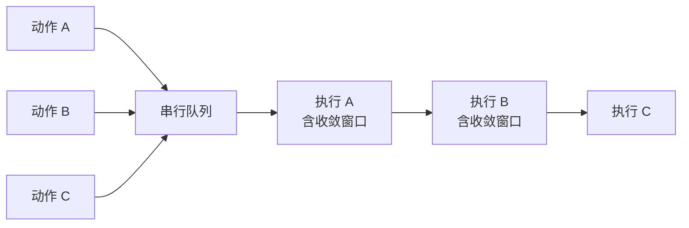
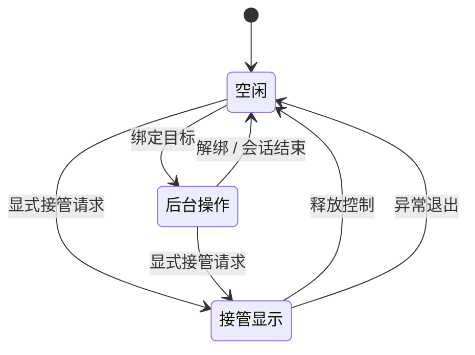

# 会话与控制租约

SCU 的会话状态、目标绑定关系，以及独占控制的获取与释放。

## 导航

- [会话](#会话)
- [目标绑定](#目标绑定)
- [串行化](#串行化)
- [控制租约](#控制租约)
- [结束与清理](#结束与清理)

## 会话

会话是一段连续的交互状态，承载：

- 当前绑定的目标
- 当前有效的快照令牌与坐标令牌
- 会话级的审批授权
- 自建窗口（指示层）的生命周期

**令牌的作用域是会话。** 切换目标会让旧目标的全部令牌失效——
因为令牌标识的是"某个目标在某个时刻的状态"，而目标已经不同了。

会话不持久化。进程退出、连接断开、显式重置都会丢弃会话状态，
但**持久级的审批授权不受影响**（见[策略与审批](policy_layer.md)）。

## 目标绑定

**绑定是显式的，且一次只绑定一个目标。**

不提供隐式选择：若调用方请求的目标在当前上下文中不唯一
（同名应用多个实例、同一 URL 多个标签页），返回歧义错误而不是任选其一。

理由：隐式选择会让调用方在不知情的情况下操作错误的目标。
一次错误目标上的点击，可能产生用户无法归因的副作用。

绑定新的目标会**隐式解绑**旧目标。调用方不需要显式解绑，
但需要知道旧令牌已因此失效。

目标的可用性会变化——应用退出、窗口关闭、标签页导航。
目标消失后的动作请求按"目标不存在"拒绝，而不是自动回退到别的目标。

## 串行化

**同一会话内的动作严格串行。**

桌面是单点资源：同一时刻只有一个元素拥有键盘焦点，
同一时刻只有一个指针位置。并行发送动作会导致：

- 事件顺序不可预测（两个点击的相对顺序取决于调度）
- 焦点竞争（A 动作设置焦点后被 B 动作夺走，A 的后续输入落到错误位置）
- 收敛判定互相干扰（无法区分是自己还是并行动作引起的变化）

因此串行化不是性能优化，是**正确性要求**。

注意收敛窗口包含在串行段内。若把它排除在外，
下一个动作可能在界面尚未稳定时就投递。

## 控制租约

系统区分两种执行模式。**本表是执行模式的规范定义**，
其他文档引用本表，不重复描述。

| 模式 | 真实指针 | 用户能否并行使用 | 需要的会话状态 | 画布映射 |
| --- | --- | --- | --- | --- |
| **后台操作** | 不动 | 可以 | 已绑定应用目标 | 目标窗口 |
| **接管显示** | 会动 | **不能** | 无要求 | 主显示器 |

### 绑定与模式正交

**绑定目标和接管显示是两件独立的事**：接管显示不需要先绑定应用目标
（它作用于整个显示，没有目标窗口），绑定目标也不隐含接管。

### 状态迁移

**升级必须显式。** 不存在从"后台操作"自动升级到"接管显示"的路径。
升级需要调用方的明确请求，且经过[策略层](policy_layer.md)判定。

**反向的过程可以自动发生**——会话结束、长时间空闲、或异常退出时
必须回落到空闲。**这个不对称是刻意的**：升级会剥夺用户对电脑的控制权，
必须是主动且有意的决定；释放只会把控制权还给用户，不需要征求同意。

### 接管模式的连带约束

- **需要确认的动作在接管模式下不可执行**（会死锁，见[策略与审批](policy_layer.md)）
- 画布只覆盖主显示器，副屏不可通过坐标操作（见 [ADR-0008](../decisions/adr_0008_coordinate_canvas.md)）
- 视觉形态必须与后台模式可区分，见[虚拟指示层](virtual_indicator.md)

## 结束与清理

会话结束时需要释放的资源：

| 资源 | 处理 |
| --- | --- |
| 指示层窗口 | 销毁 |
| 自建窗口登记 | 清空 |
| 控制租约 | 释放，回落到后台模式 |
| 快照与令牌 | 丢弃 |
| 会话级审批授权 | 丢弃 |
| 持久级审批授权 | **保留** |

**清理必须在异常路径上也发生。** 进程崩溃、连接中断、
宿主应用强制退出时，指示层不应残留在屏幕上，
控制租约不应保持占用。

参考实现中观察到在中断、子代理结束、正常结束三类事件上都挂了清理钩子，
覆盖了异常路径。SCU 采用同等覆盖范围的清理触发点。
