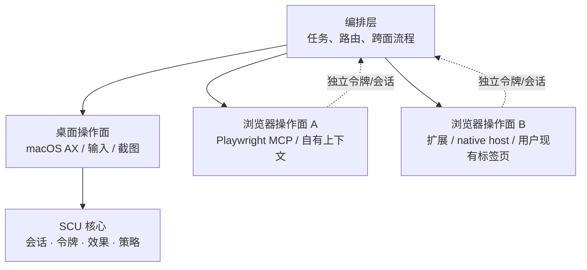

# 操作面模型：桌面、浏览器与编排

<a id="surface_model"></a>

## 导航

- [不是四层，而是三个操作面](#不是四层而是三个操作面)
- [为什么浏览器要单列](#为什么浏览器要单列)
- [适配器边界](#适配器边界)
- [路由规则](#路由规则)
- [令牌、效果与策略](#令牌效果与策略)
- [当前状态与规划](#当前状态与规划)
- [不做什么](#不做什么)

## 不是四层，而是三个操作面

SCU 的核心不是“一个进程操作所有东西”，而是**对不同操作面提供同一套可验证语义**：



三个操作面：

| 操作面 | 目标 | 首选实现 | 当前状态 |
| --- | --- | --- | --- |
| **桌面** | 原生应用、窗口、菜单、系统对话框 | SCU 原生层：AX + 输入 + 截图 | 已实现 |
| **浏览器（自有上下文）** | 可复现的网页任务、测试、无用户登录态 | Playwright MCP | 外部工具，SCU 不内置 |
| **浏览器（用户上下文）** | 用户已打开的标签页、登录态、下载和文件选择 | 浏览器扩展 + native host / CDP | 未实现，规划中 |

**编排层不是第四个操作面。** 它是选择操作面、拆分任务、合并结果和做跨面核对的地方。
“Super”应当体现在这里，而不是把每个操作面都重写一遍。

## 为什么浏览器要单列

浏览器内部有页面语义：DOM、ARIA、iframe、下载、文件选择、标签页生命周期。
这些不是 macOS AX 能可靠表达的：

- 网页的 AX 树可能很大、动态变化，`AXPress` 经常是空操作；
- 浏览器外壳（地址栏、标签页、扩展菜单）仍属于原生 UI；
- 用户现有标签页的 Cookie、登录态和页面状态不能由新开的 Playwright context 继承。

因此浏览器至少有两种不同的目标：

1. **自有上下文**：可复现、隔离、适合测试；Playwright MCP 是代表。
2. **用户上下文**：需要接管现有标签页；Codex Browser 插件是代表。

Codex 的做法是扩展 + native messaging host + tab claim + `chrome.debugger`/CDP，
再把页面能力包装成 Playwright 风格 API。它不是 Playwright MCP，也不是 SCU 的 AX 路径。

## 适配器边界

SCU 核心不直接实现浏览器引擎，而是面对一个**浏览器适配器**契约。概念接口：

```text
BrowserAdapter
  listTabs()        -> TabRef[]
  claimTab(TabRef)  -> BrowserSession
  snapshot()        -> BrowserSnapshot + token
  act(action)       -> BrowserEffect
  release()         -> void
```

约束：

- `TabRef` 必须是运行时分配的稳定引用；URL 只用于查找，不能当身份；
- `claimTab` 要明确“用户自有”与“自动化创建”的归属，不能混用；
- 浏览器快照令牌和桌面快照令牌是**不同命名空间**，不能互相替代；
- 浏览器动作必须有自己的 effect：URL、title、DOM/AX 变化、截图变化；
- 适配器可以来自 Playwright MCP、CDP endpoint 或扩展/native host，SCU 核心不感知具体传输。

当前只是设计，不是已实现的线协议或 MCP 工具。

### 候选 MCP 工具面（草案，未实现）

如果将来由 SCU 自己承载浏览器适配器，工具面控制在四个动作加一个释放，而不是把
Playwright MCP 的全部工具复制进来：

| 候选工具 | 作用 | 关键约束 |
| --- | --- | --- |
| `browser_list_tabs` | 列出浏览器/会话中的标签页 | 返回稳定 `tab_id`、标题、URL、归属（用户/自动化）；URL 不是身份 |
| `browser_claim_tab` | 接管一个用户标签页 | 必须显式指定 `tab_id`；歧义/无权限时失败，不回退到“最近打开” |
| `browser_snapshot` | 读取页面快照 | 返回快照令牌与页面 revision；DOM 与 AX 由后端决定，不伪装成桌面树 |
| `browser_action` | 点击、输入、导航、滚动等 | 必须带快照令牌与浏览器句柄；effect 回报 URL/title/DOM 变化 |
| `browser_release_tab` | 释放 claim | 幂等；不关闭用户标签页，除非调用方显式请求 |

字段名、错误码和传输都未定；不要把这张表当成线协议承诺。当前 MCP 工具列表没有这些工具。

## 路由规则

默认按任务选择操作面，而不是按“哪个工具更容易调用”选择：

| 任务 | 操作面 |
| --- | --- |
| 打开 URL、网页表单、页面按钮、读网页内容 | 浏览器（自有上下文），优先 Playwright MCP |
| 已登录的用户标签页、现有浏览器会话 | 浏览器（用户上下文），扩展/CDP 适配器 |
| 地址栏、菜单、扩展、浏览器原生对话框 | 桌面，SCU |
| 原生应用、Finder、TextEdit、系统设置 | 桌面，SCU |
| 下载后整理文件、浏览器与原生应用联动 | 编排层：浏览器负责页面，SCU 负责桌面 |

规则：

1. **网页内容不要用 macOS AX 猜。** 能在浏览器操作面完成的，不走 `get_ax_state`。
2. **浏览器外壳不要交给 Playwright。** 地址栏、菜单、文件选择器、系统面板由 SCU 处理。
3. **不要同时驱动同一个浏览器窗口。** 两个操作面并行会争焦点、标签页和登录态；要并行就分 profile 或分窗口。
4. **跨面流程由编排层显式建立关联。** 例如“下载文件后移动它”，浏览器 effect 只负责下载完成，文件操作由 SCU 重新绑定目标。

## 令牌、效果与策略

三种操作面共享**语义**，不共享**句柄**：

| 概念 | 桌面 | 浏览器 |
| --- | --- | --- |
| 目标 | pid + window + element handle | browser/session + tab + page revision |
| 令牌 | SCU snapshot token | browser snapshot token |
| 效果 | delivered / treeChanged / targetChanged / noOpSuspected | URL/title/DOM/AX diff + screenshot diff |
| 策略 | 应用允许列表 + 拒绝类目 | 还需要 origin 级允许列表与提交/上传确认 |

浏览器策略不能只复用 `--allow-app`：应用允许列表只回答“能不能操作这个浏览器”，
不回答“能不能在这个网站提交表单、上传文件或读取敏感页面”。这两层需要分开。

## 当前状态与规划

**当前（0.4.0）**：只实现桌面操作面。没有浏览器适配器，没有扩展，没有 tab claim。
`list_windows`、`get_ax_state(window=...)` 操作的是浏览器窗口，不是网页语义。

**规划顺序**：

1. **路由与文档**（本次）：明确三种操作面，SCU 不把网页当 AX 树。
2. **浏览器适配器接口**：先接 Playwright MCP 或 CDP endpoint，拿到标签页、页面快照和动作效果。
3. **现有用户标签页**：只有在“必须无感接管当前浏览器”时，才做扩展 + native host。
4. **统一策略与效果**：origin 允许列表、提交/上传确认、跨面令牌隔离。

第 2 步之前，SCU 的 MCP 面不增加浏览器工具；第 3 步之前，不发布浏览器扩展。

### 里程碑（草案）

| 里程碑 | 内容 | 出口条件 |
| --- | --- | --- |
| M0 文档与路由 | 操作面边界、路由规则、与 ADR-0010 的关系 | 文档评审通过；不改代码 |
| M1 只读适配器 | `list_tabs` + `snapshot`，先接 Playwright MCP 或 CDP | 能读一个网页的标题/URL/快照；令牌与桌面令牌隔离 |
| M2 动作适配器 | `claim_tab` / `action` / `release_tab` | 动作有 effect；origin 允许列表生效；失败关闭 |
| M3 用户现有标签页 | 扩展 + native host | 只有真实任务证明“必须无感接管当前标签页”才启动 |

M1/M2 的适配器可以是 SCU 外部的服务；M3 才涉及浏览器扩展的分发与安全评审。

## 不做什么

- 不把 Playwright MCP 的全部工具原样塞进 SCU 的 MCP 服务；这会造成工具面膨胀、
  认证和生命周期冲突。编排层可以分别调用两个服务。
- 不让浏览器句柄和桌面句柄共用一个 ID 空间。
- 不为“看起来更 super”而自研浏览器扩展；先证明现有标签页接管是必要能力。
- 不把浏览器页面当成“另一个 AX 应用”来长期维护。

## 相关文档

- [系统总览](system_overview.md)
- [目标发现与绑定](../interfaces/target_discovery.md)
- [策略与审批](policy_layer.md)
- [ADR-0010 范围限定为 UI 自动化](../decisions/adr_0010_ui_automation_only.md)
- [ADR-0030 浏览器操作面通过适配器接入](../decisions/adr_0030_browser_surface.md)
- [浏览器操作面规划的证据](../../verification/external-sources.md)
