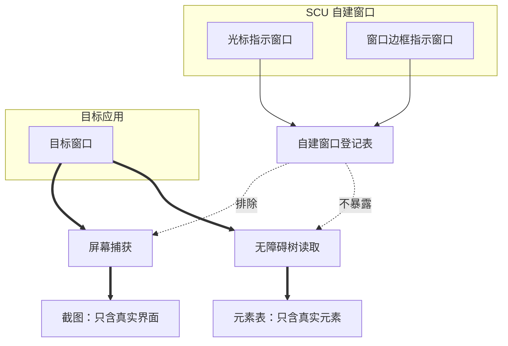
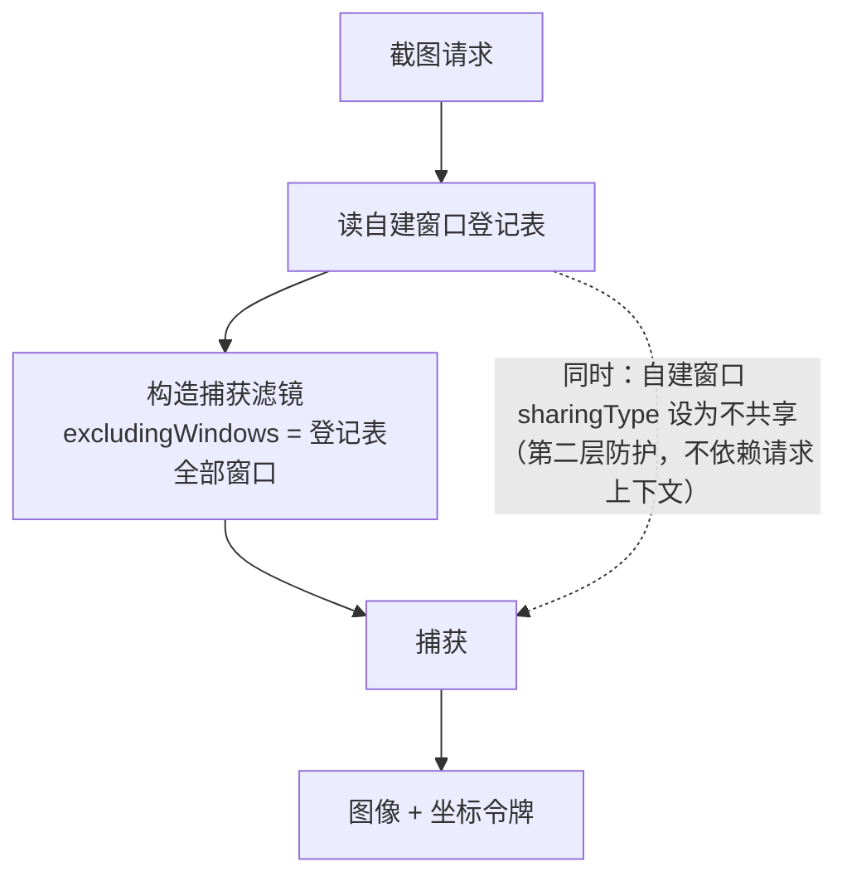
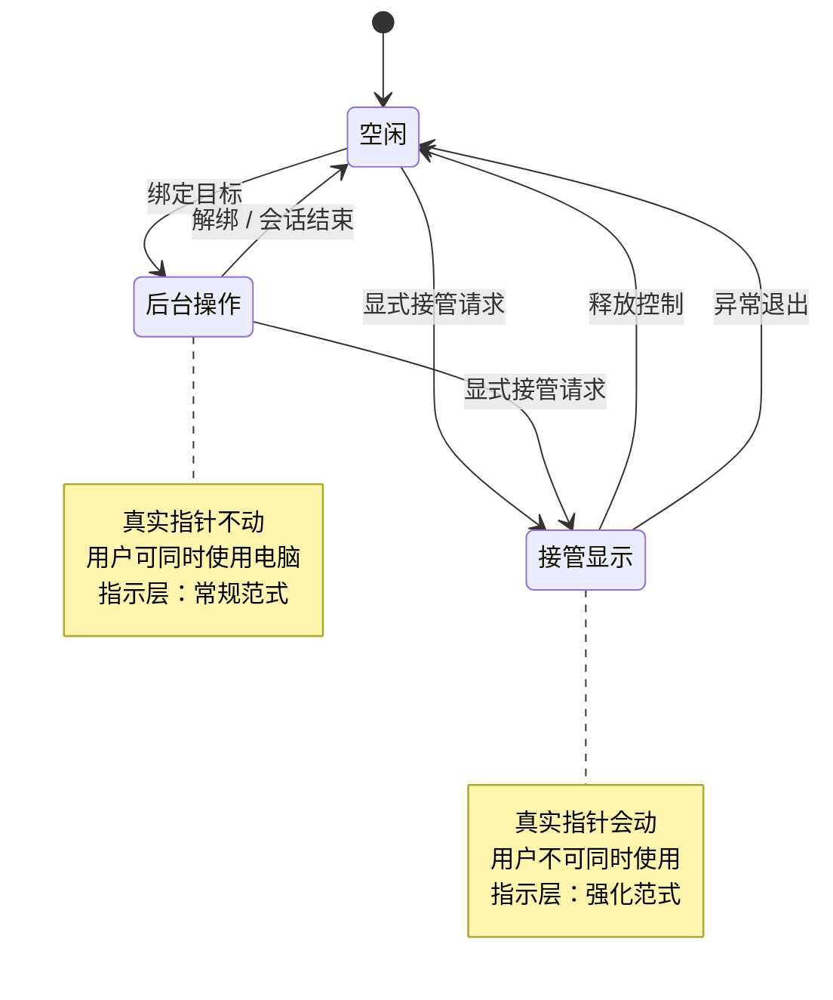

# 虚拟指示层

SCU 如何在屏幕上显示"正在操作哪里"。这是 AX 优先寻址（[ADR-0001](../decisions/adr_0001_accessibility_first.md)）
直接带来的需求，设计理由见 [ADR-0007](../decisions/adr_0007_virtual_indicator_layer.md)。

## 外部观察来源

本文涉及对两套已发布实现的观察结论。来源、具体证据与复核方法见
[verification/external-sources.md](../../verification/external-sources.md)。

## 导航

- [为什么必需](#为什么必需)
- [结构：谁被排除](#结构谁被排除)
- [指示元素](#指示元素)
- [与截图管线的冲突](#与截图管线的冲突)
- [执行模式的可视区分](#执行模式的可视区分)
- [约束](#约束)

## 为什么必需

SCU 的主寻址路径是元素引用，通过无障碍接口对元素执行动作。
**这个过程不会移动系统的真实指针。**

后果是：用户看到界面自己变了，但看不到"是谁在动"。在一个只读的观察者眼里，
应用像是被远程控制了——事实上确实如此，只是没有任何视觉线索说明控制点在哪里。

静默的界面变化在下列场景中会造成实际困扰：

- 用户不确定 agent 是否在操作当前窗口，还是别的窗口
- 用户想在 agent 点错之前打断，但不知道它正要点哪里
- 排查问题时，事后无法判断当时点到了哪个控件

虚拟指示层解决的是这个问题：**把"不可见的操作点"变成可见的。**

参考实现中的同类机制：

| 实现 | 指示元素 |
| --- | --- |
| Codex Computer Use | 雾状光标（可切换指针样式），箭头形覆盖窗口 |
| Grok Bot Computer Use | 光标覆盖层、被控窗口边框高亮、接管模式辉光 |

两者都独立实现了这一层，与 AX 优先的选择同时出现。这不是巧合：
**选择了 AX 寻址，就必须补偿它缺失的视觉反馈。**

## 结构：谁被排除

指示层是真实窗口，因此必须在两条读取路径上都被排除：捕获路径和不无障碍树路径。

**登记表是单一事实来源。** 自建窗口在创建时登记，在销毁时注销；
两条排除路径都从同一张表取数据，而不是各自维护窗口列表。
否则两条路径会有不一致的风险：截图排除了、元素表没排除，反之亦然。

两条路径的排除机制不同：

| 路径 | 排除方式 | 失败后果 |
| --- | --- | --- |
| 屏幕捕获 | 共享类型 + 捕获滤镜排除窗口 | 截图出现幽灵元素，模型可能尝试操作它 |
| 无障碍树 | 指示窗口不暴露无障碍信息 | 元素表出现幽灵元素，元素引用指向不存在的东西 |

**两条都必须兼顾。** 只排除截图不排除元素表，会出现一个“看不见但可点击”的幽灵元素；
只排除元素表不排除截图，会出现一个“看得见但点不到”的图形。

## 指示元素

首版设计包含两个元素：

### 操作点指示

在当前动作的目标位置显示一个标记。

- 对元素寻址的动作，标记在元素的无障碍坐标系上定位，而不是在鼠标位置
- 对坐标寻址的动作，标记在给定坐标
- 动作结束后短暂保留，然后淡出

样式待定。参考实现使用了一个半透明的柔和光斑，这个选择是合理的：
它不遮挡下面的界面内容，也不与系统原生指针混淆。

### 目标窗口指示

高亮当前绑定的目标窗口的边框。

这个元素的信息量比操作点更大：用户一眼就能看出**agent 在操作哪个窗口**。
在多窗口场景下，仅靠操作点很难判断范围。

窗口切换时指示应随之移动，让用户能察觉到目标发生了改变。

## 与截图管线的冲突

**指示层必须不出现在 SCU 自己的截图里。** 这不是可选的优化，是硬要求。

如果指示层被截进图里：

1. **浪费**：每次截图都包含一个与任务无关的图形
2. **误导**：模型可能把指示层当成真实的界面元素并尝试操作它
3. **污染几何**：指示层改变像素内容，可能干扰基于像素的比对

参考实现使用了两层防护，SCU 沿用：

| 机制 | 作用 |
| --- | --- |
| 窗口共享类型设为不共享 | 使窗口对屏幕捕获与录制不可见 |
| 捕获时排除指定窗口 | 在内容过滤器构造时显式排除指示窗口 |

第一层是首选，第二层是兜底。第二层存在的理由是：共享类型在某些捕获路径下
可能不生效，显式排除是更可靠的保证。

截图请求的完整处理路径：

注意第二层防护是**窗口自身的属性**，与截图请求无关。即使某次截图遗漏了排除列表，
共享类型仍会阻止指示层进入图像。两层都失效才会泄露。

此外，指示窗口必须**不接收鼠标事件**，否则它会挡住 agent 自己的点击，
或者拦截用户意图打断的操作。

## 执行模式的可视区分

参考实现中观察到一个值得借鉴的做法：Grok 在"接管显示并移动真实指针"的
升级模式下显示不同的视觉效果（辉光）。

这提示一个更普遍的设计原则：**指示层应当让用户区分"agent 在后台操作"
和"agent 接管了鼠标键盘"。**

这两种状态的风险等级完全不同（定义见
[会话与控制租约](session_and_lease.md)的规范表：一个不动真实指针、
用户可以并行使用电脑，另一个两者都相反）。

**用户必须能一眼分辨。** 若两种模式视觉上一样，用户可能在不知情的情况下
试图同时操作，或者误以为 agent 只是"在后台点点"而没有意识到键盘控制权已被拿走。

**本节只规定视觉要求**；模式的定义与迁移规则归属
[会话与控制租约](session_and_lease.md)，不在此重复。

上图的模式定义来自[会话与控制租约](session_and_lease.md)，
此处只标出**每个模式下指示层的视觉差异**。

## 约束

- **指示层不参与无障碍树。** 它不能出现在 SCU 自己读取的元素表里。
  这是一个真实的陷阱：指示窗口是真实窗口，如果它暴露了无障碍信息，
  agent 会看到自己造的幽灵元素。
- **指示层不夺焦点。** 窗口不能成为 key window，也不能激活所属应用。
- **指示层可关闭。** 用户应当可以完全关掉它，包括在无人值守的场景下。
- **指示层不改变几何。** 它不能影响目标窗口的位置、尺寸或无障碍坐标系。

## 未定项

- 指示层的具体视觉样式（形状、颜色、淡出时长）
- 是否需要在连续动作之间保持指示，避免闪烁
- 多显示器和跨屏拖动时指示层如何跟随
- Linux 侧的实现方式（合成器支持程度不一，可能无法做到捕获排除）
