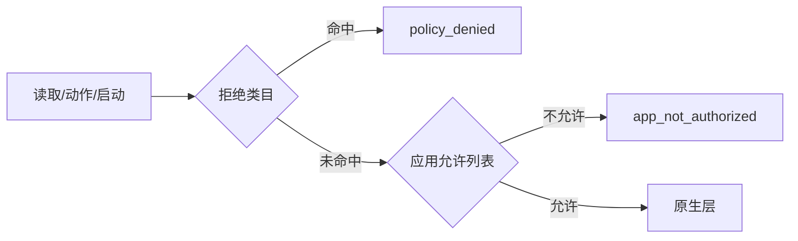

# ADR-0024 连接级应用允许列表

- **状态**：已接受（实验性）
- **日期**：2026-10-20

## 背景

SCU 之前只有不可绕过的拒绝类目，没有“允许使用哪些应用”的正面授权。
不同的宿主（Codex、Grok、pi 或其他 MCP 客户端）各自启动一个 `scu mcp`
进程；如果让 SCU 维护跨宿主的 session，会引入 session id、租约、并发和
身份问题，明显过重。

参考实现的运行时审批（[验证记录](../../verification/2026-10-20-approval-triggers.md)）
也都落在宿主侧：Codex 用 MCP elicitation，Grok 用聊天卡片；原生服务只接收
“应用 + 决定”，不维护通用会话数据库。

## 决策

### 1. 一个 `scu mcp` 进程 = 一条连接 = 一个授权作用域

- 授权状态只在进程内，进程退出即消失；
- 不要求宿主传 session id；
- 不在不同宿主之间共享授权；
- 不实现 TTL、心跳、租约或跨进程同步。

### 2. 默认允许全部，显式配置后才启用允许列表

- 不传 `--allow-app` / `--allow-app-file`：保持原有行为，只受拒绝类目约束；
- 传了任一参数：进入 `allowlist` 模式，列表外的应用在读取和动作之前被拒绝；
- 空允许列表（显式传了空文件）表示“全部拒绝”，不是“恢复默认”。

理由：允许列表是安全收紧，不是默认行为；默认收紧会破坏现有用户和测试，
也会让没有配置能力的宿主无法使用。

### 3. 启动时解析成 bundle id

`--allow-app` 接受 bundle id、显示名或 `.app` 路径，启动时用
`WorkspaceAppLauncher.resolve` 解析成 bundle id；解析不到就拒绝启动。
匹配时去空白、转小写。显示名只用于解析，不参与后续匹配。

`--allow-app-file` 支持 JSON 字符串数组，也支持一行一个标识；`#` 开头的行忽略。
文件是**只读输入**，SCU 不写它，也不提供“永久允许”的 UI。

### 4. 在原生层之前拦截

检查顺序：

- 读取：在 `readTree` / `captureWindow` 之前确认身份，避免先读到数据再拒绝；
- 动作：在解析定位器、联系原生层之前；
- 启动：先解析 bundle id、过拒绝类目，再检查允许列表。

`list_apps` 不过滤：它只返回运行列表，不读取应用内容，宿主仍需要发现目标。

### 5. 拒绝是 `app_not_authorized`，不是 `policy_denied`

- `policy_denied`：不可协商的拒绝类目，永远不能通过配置放行；
- `app_not_authorized`：本次连接的允许列表没包含它，用户调整配置并重启后可恢复；
- 两者都是 `retry: no`，因为当前连接内重试不会改变结果。

## 取舍

**接受了重启才能改授权的成本。** 没有运行时 `authorize_app` 工具：
模型可以自己调用这种工具，等于假审批；真正的“问用户”应由宿主完成。
如果宿主需要交互式授权，应当在宿主侧实现，然后以启动参数或重启方式生效。

**接受了允许列表的粗粒度。** 它只认应用，不认窗口、标签页、URL 或动作；
不能表达“只允许读这个应用的聊天窗口”。这些属于更细的策略，暂不做。

**接受了按宿主分文件的手工配置。** 没有默认的全局 `allowed-apps.json`：
不同宿主的信任级别不同，默认共享会让 Codex 的授权被 pi 继承。
用户可以为每个宿主传不同文件；硬拒绝类目仍然全局生效。

**没有阻止 `list_apps` 看到列表外的应用。** 应用名和 bundle id 不是应用内容；
发现目标需要它。真正的数据读取在 `get_ax_state` / `get_screenshot` 处被拦截。

## 后果

- CLI 新增 `--allow-app`、`--allow-app-file`；
- `DesktopSession` 持有连接级 `AppAuthorization`；读取、动作、启动都过它；
- 新增错误码 `app_not_authorized`；
- 不改线协议（仍是 v9），不改原生层；
- 文档需要说明：这是连接级允许列表，不是逐动作审批，也不是 SCU 维护的 session 服务；
- 真实应用验证需要覆盖“允许的应用可读、列表外应用在读取前被拒”。

## 相关文档

- [MCP 接入面](../interfaces/mcp_surface.md)
- [策略与审批](../architecture/policy_layer.md)
- [错误码表](../interfaces/error_taxonomy.md)
- [审批触发证据](../../verification/2026-10-20-approval-triggers.md)
