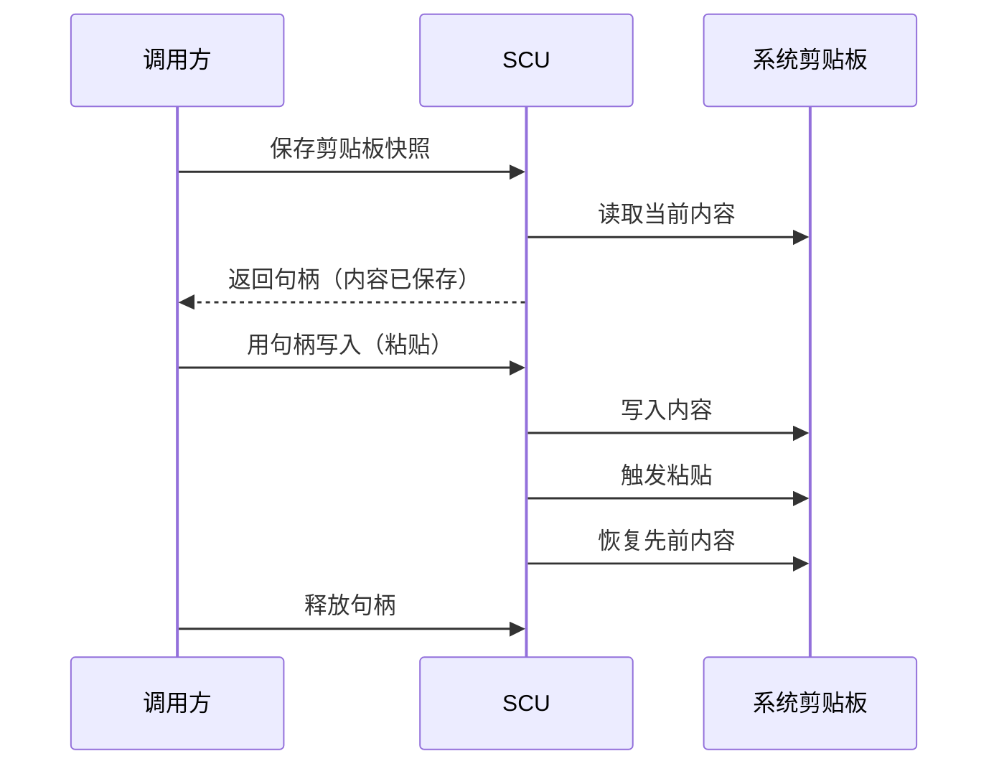

# 编辑类操作语义

文本写入、选择、剪贴板与拖拽的语义约定。动作的统一形态见
[协议总览](protocol_overview.md)，元素引用的格式见[元素寻址](element_addressing.md)。

## 导航

- [三种写入路径](#三种写入路径)
- [写入的目标解析](#写入的目标解析)
- [选择语义](#选择语义)
- [剪贴板的快照语义](#剪贴板的快照语义)
- [拖拽](#拖拽)
- [快捷键与修饰键](#快捷键与修饰键)

## 三种写入路径

把文本送进一个输入框有三条路径，代价与副作用不同：

| 路径 | 机制 | 触发输入法 | 触发应用按键处理 | 速度 |
| --- | --- | --- | --- | --- |
| 设值 | 通过无障碍接口直接写值属性 | 否 | 否 | 快 |
| 逐字输入 | 合成按键事件 | 是 | 是 | 慢 |
| 粘贴 | 写入剪贴板后触发粘贴 | 否 | 是 | 中 |

**默认应当使用设值。** 它不依赖键盘布局、不受输入法干扰、
不会误触发快捷键，且速度最快。参考实现中的能力说明也把设值列为首选。

设值的局限是**它绕过了应用的真实输入流程**。以下情况下必须改用逐字输入：

- 应用在输入过程中做实时处理（自动完成、实时校验、增量搜索）
- 输入需要触发按键级事件（回车提交、Tab 切换字段）
- 元素不支持设值（只读属性，或未暴露可写接口）

参考实现中观察到对设值的显式支持检查：只有当元素声明了
对应的可写属性时才允许设值。SCU 沿用这一约束——
对不支持的元素调用设值时**拒绝**，而不是回退到逐字输入。

回退是危险的：调用方以为发生了设值（原子、快速），
实际发生了逐字输入（有中间状态、可能触发部分匹配）。两者的副作用不同。

## 写入的目标解析

写入类动作需要知道"写到哪里"。解析顺序：

1. **显式给出的元素引用** — 优先级最高
2. **当前焦点元素** — 仅在其可编辑且可见时

若无显式引用且当前焦点不可编辑，**拒绝执行**，不猜测目标。

参考实现中观察到明确的拒绝语义："未命中点击目标的输入会被拒绝"，
并要求调用方先点击一个输入框。SCU 采用同样的严格性：
不接受"先在某个地方输入，之后再调整"这种含糊的操作。

原因是写入是**有副作用且不可自动撤销**的。一个投递到错误位置的
输入可能触发搜索、发送消息、或者提交表单。拒绝的代价是调用方多一步，
猜测错误的代价可能是不可逆的。

## 选择语义

选择文本需要处理**文本不唯一**的问题：同一个输入框里可能有多处相同文本。

参考实现中的做法是允许调用方提供**前后文片段**来消歧：
给出目标文本以及它前后的若干字符，从而唯一定位。

另外需要区分三类选择意图：

| 意图 | 结果 |
| --- | --- |
| 选中文本 | 文本被高亮选中 |
| 光标置于文本前 | 不选中，插入点在前 |
| 光标置于文本后 | 不选中，插入点在后 |

后两者用于"在指定位置插入"而非"替换"。

**多处匹配且未提供消歧信息时，拒绝执行。** 与写入同理：
选中错误的位置会导致后续输入覆盖错误的文本。

## 剪贴板的快照语义

剪贴板是**全局共享状态**。直接读写会破坏用户剪贴板中已有内容，
这是一个容易被忽视的副作用：用户复制了一段内容，自动化过程把它冲掉了。

SCU 采用**句柄式**剪贴板访问，而不是直接读写：

关键性质：

- 句柄代表一份**快照**，不是对系统剪贴板的持续引用
- 用句柄写入后**恢复**原内容
- 同一句柄**可重复使用**，不因一次写入而失效
- 句柄需要显式释放

**快照而非引用**的原因：系统剪贴板的内容可能被其他进程改变。
如果句柄是引用，调用方以为写入了 A，实际写入的是别的东西。

## 拖拽

拖拽由两个坐标定义：起点与终点。

与普通坐标动作相同，两者都受[坐标令牌](../architecture/snapshot_lifecycle.md)约束，
且坐标是[固定画布](../decisions/adr_0008_coordinate_canvas.md)坐标而非屏幕坐标。

拖拽的一个特殊之处是**中间过程可见**：从按下到释放之间，
用户的界面处于"拖拽中"状态。这个状态的持续时间由调用方控制，
期间应用可能触发悬停预览、自动滚动等行为。

**中断必须能恢复到确定状态。** 若拖拽过程中会话结束或发生错误，
必须释放鼠标按键，不能把系统留在按键按下的状态——
那会让用户完全失去对鼠标的控制。

## 快捷键与修饰键

按键动作接受组合键，格式为**以加号分隔的键名序列**。

两个需要明确的语义：

- **修饰键的顺序无关**。修饰键与主键的相对顺序不影响结果
- **按住不放与单次按下是不同动作**。前者跨越多个动作，
  用于组合操作（如按住 Shift 连续点击选择范围）

按住不放引入了状态：按住之后必须有对应的释放。
这个状态属于会话，**会话结束必须确保所有按键已释放**。

若残留按住状态，用户的键盘行为会持续异常，且难以归因。
