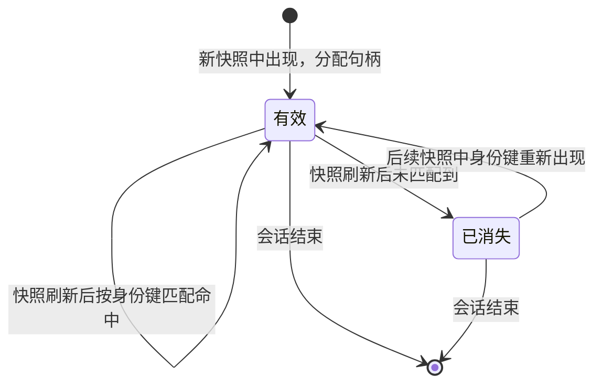

# 元素寻址

元素引用的字符串格式与解析规则。身份的构造算法见
[元素身份](../architecture/element_identity.md)。

## 导航

- [格式](#格式)
- [元素表](#元素表)
- [解析规则](#解析规则)
- [句柄的生命周期](#句柄的生命周期)
- [坐标引用](#坐标引用)

## 格式

```
<role>#<handle>
```

示例：

```
AXTextField#t7
AXButton#1a
AXStaticText#3f
AXRow#2k
```

- `role`：平台角色名，去掉 `AX` 前缀亦可。**这是给人看的冗余信息**
- `handle`：会话内递增的短标识。它是**权威部分**，也是唯一被解析的部分

**句柄是不透明的。** 调用方不应假设它的长度、字符集或生成规则。
SCU 可以随时改变生成方式而不影响协议。

**`role` 前缀是可选的。** 解析时忽略它——只要句柄正确，前缀写错也能命中；
句柄错误时，前缀正确也不会命中。这样设计是为了让模型或人复制的引用
不会因为前缀判断失误而失败。

## 元素表

```
[AXWindow#1] "网易云音乐"
  [AXTextField#t7] "搜索" value="" actions=[press]
  [AXButton#1a] "搜索"
  [AXList#2d]
    [AXRow#2k] "周杰伦 - 晴天"
    [AXRow#2m] "周杰伦 - 七里香"
```

- **缩进表示层级。** 每级两空格。比输出父节点引用更省 token，且人类可读
- **每行是完整引用。** 可直接切片使用，无需解析结构
- 属性按固定顺序输出，缺省则省略：

| 属性 | 形式 | 出现条件 |
| --- | --- | --- |
| 值 | `value="..."` | 元素有值且非空 |
| 次要动作 | `actions=[a,b]` | 元素声明了点击之外的动作 |
| 状态 | `state=focused,selected` | 元素有非默认状态 |

默认只输出与上一次的差异。完整表需要显式请求（见
[协议总览](../interfaces/protocol_overview.md)的 `refresh` 参数）。

## 解析规则

1. **句柄优先。** 提取 `#` 之后的部分作为句柄，忽略 `role` 前缀
2. **句柄必须在当前会话的注册表中存在**，否则按
   [失效模型](../domains/staleness_model.md)处理
3. **句柄与坐标不可同时给出。** 同时给出时拒绝执行，不做优先级推断
4. **不做"最接近的匹配"。** 句柄写错就是错，不猜测意图

## 句柄的生命周期



**句柄跨快照保持。** 只要身份键能匹配上，同一元素在多次快照中拿到的句柄相同。
这是[元素身份](../architecture/element_identity.md)的直接结果。

**已消失的句柄不代表失效。** 元素可能只是暂时离开可见区域
（滚动、折叠、切换标签页）。再次出现时身份键会重新匹配，句柄恢复有效。
这与令牌失效是两件不同的事——后者表示"状态已变，不能信任旧数据"。
