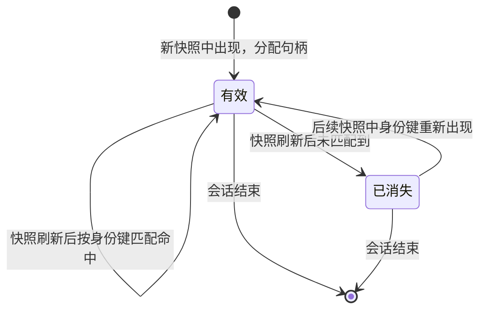

# 元素寻址

元素引用的字符串格式与解析规则。身份的构造算法见
[元素身份](../architecture/element_identity.md)。

## 导航

- [格式](#格式)、[元素表](#元素表)：对外形态
- [解析规则](#解析规则)、[句柄的生命周期](#句柄的生命周期)：语义与状态

## 格式

```
<role>#<handle>
```

示例：

```
AXTextField#t7
AXButton#1a
AXStaticText#3f
AXRow#2k
```

- `role`：平台角色名，去掉 `AX` 前缀亦可。**这是给人看的冗余信息**
- `handle`：会话内递增的短标识。它是**权威部分**，也是唯一被解析的部分

**句柄是不透明的。** 调用方不应假设它的长度、字符集或生成规则。
SCU 可以随时改变生成方式而不影响协议。

**`role` 前缀是可选的。** 解析时忽略它——只要句柄正确，前缀写错也能命中；
句柄错误时，前缀正确也不会命中。这样设计是为了让模型或人复制的引用
不会因为前缀判断失误而失败。

## 元素表

```
[AXWindow#1] "网易云音乐"
  [AXTextField#t7] "搜索" value="" actions=[press]
  [AXButton#1a] "搜索"
  [AXList#2d]
    [AXRow#2k] "周杰伦 - 晴天"
    [AXRow#2m] "周杰伦 - 七里香"
```

- **缩进表示层级。** 每级两空格。比输出父节点引用更省 token，且人类可读
- **每行是完整引用。** 可直接切片使用，无需解析结构
- 属性按固定顺序输出，缺省则省略：

| 属性 | 形式 | 出现条件 |
| --- | --- | --- |
| 值 | `value="..."` | 元素有值且非空 |
| 次要动作 | `actions=[a,b]` | 元素声明了点击之外的动作 |
| 状态 | `state=focused,selected` | 元素有非默认状态 |

默认只输出与上一次的差异。完整表需要显式请求（见
[协议总览](../interfaces/protocol_overview.md)的 `refresh` 参数）。

<a id="readonly_subset"></a>

### 已实现的只读子集

[MCP 接入面](mcp_surface.md)输出的元素表是上述格式的**子集**，与设计的差异如下：

| 项 | 设计 | 只读档实际 |
| --- | --- | --- |
| 句柄 | 会话内递增，跨快照延续 | **本次读取内**按完整树的先序编号（从 1 起，与是否显示无关），每次读取重新编号，不延续；与**令牌**配对使用（令牌沿用时编号相同） |
| 谁接受句柄 | 全部动作 | 只有 `click`（仅 `scu mcp --actions`），必须同时给出令牌；默认档没有工具接受句柄 |
| 差异输出 | 默认只输出与上一次的差异 | 没有差异输出；元素多于上限时按层级优先显示，被折叠的元素行尾标 `(折叠 N)`；`focus` 只展开一部分，子树前有 `@ 祖先链` 行（格式见 [MCP 接入面](mcp_surface.md#概览与展开)）。见 [MCP 接入面](mcp_surface.md#概览与展开) |
| `actions=[...]`、`state=focused,selected` | 有 | 没有（原生层不读取动作与焦点） |
| 属性顺序 | 值、动作、状态 | 标题、`subrole=`、`desc=`、`value=`、`id=`、`state=disabled`；缺省或为空则省略 |

只读档新增了设计里没有的 `subrole`、`desc`、`id`：它们是已读到的真实字段，
关闭按钮之类的控件没有标题，只靠 `subrole` 或 `desc` 才能区分。
`state=disabled` 来自 `AXEnabled == false`。

`title`、`desc`、`value`、`id` 被转义（`\`、`\"`、换行、回车、制表符）并截断到 120 个字符，保证"一行一个元素"；`subrole=` 原样拼接，不加引号、不转义、不截断（AX 的 subrole 是不含空白的常量名）。
句柄暂缓跨快照延续的理由见 [ADR-0013](../decisions/adr_0013_p0_vertical_slice.md#暂缓句柄注册表)。

## 解析规则

1. **句柄优先。** 提取 `#` 之后的部分作为句柄，忽略 `role` 前缀
2. **句柄必须在当前会话的注册表中存在且状态为有效**，
   否则返回 `element_gone`（见下节）
3. **句柄与坐标不可同时给出。** 同时给出时拒绝执行，不做优先级推断
4. **不做"最接近的匹配"。** 句柄写错就是错，不猜测意图

## 句柄的生命周期



**句柄跨快照保持。** 只要身份键能匹配上，同一元素在多次快照中拿到的句柄相同。
这是[元素身份](../architecture/element_identity.md)的直接结果。

**已消失的句柄不代表失效。** 元素可能只是暂时离开可见区域
（滚动、折叠、切换标签页）。再次出现时身份键会重新匹配，句柄恢复有效。
这与令牌失效是两件不同的事——后者表示"状态已变，不能信任旧数据"。

### 用已消失的句柄发起动作

返回 `element_gone`，`retry: after_refresh`。

**不静默忽略，也不自动重试。** 调用方需要先重新读取状态，
再判断该元素是否重新出现。理由：

- 静默忽略会让调用方以为动作生效了
- 自动重试在元素确实消失时会反复失败，且掩盖了真实原因

这与"句柄不在注册表中"是同一个错误码——对调用方而言，
"这个引用现在指不到东西"是同一件事，不需要区分它曾经存在过。
