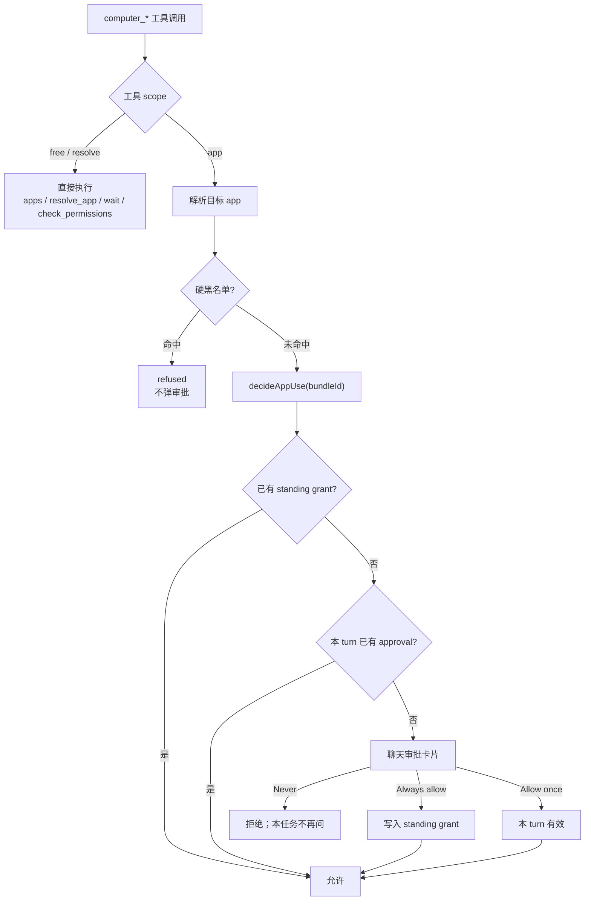
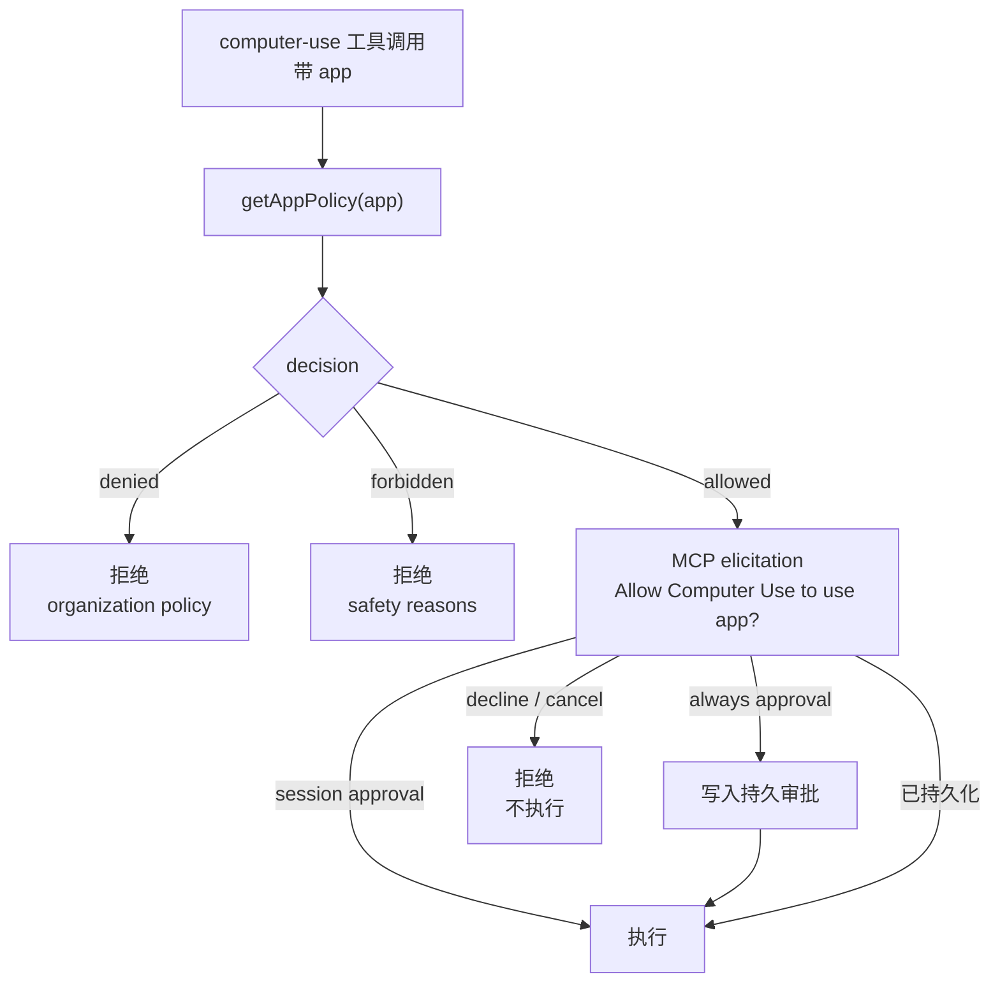

# 审批触发：Grok Bot 与 Codex Computer Use

采集日期：2026-10-20。本文记录**工件中的静态事实**与由此得出的推断，
不把静态代码当成运行时观察。工件版本与哈希见
[external-sources.md](external-sources.md)。

## 结论摘要

两套实现都有审批，但**都不是“每次点击都确认”**：

- **Grok Bot**：运行时强制，粒度是**应用**。第一次使用一个未获授权的应用时，
  在聊天里弹出审批卡片；选项是 `Always allow` / `Allow once` / `Never`。
  `Allow once` 覆盖当前 turn，`Always allow` 持久保存并可在设置里撤销。
  终端、脚本、密码管理器、系统设置等命中硬黑名单时**不弹审批，直接拒绝**。
- **Codex Computer Use**：两层。
  1. **运行时**：每个 computer-use 调用先问 `getAppPolicy`，只有 `allowed` 才发起
     MCP elicitation（“Allow Computer Use to use …?”），批准可记为 session 或 always；
     `denied` / `forbidden` 直接拒绝，不弹。
  2. **提示词**：`SKILL.md` 里的 “Computer Use Confirmations Policy” 按动作语义
     要求模型在聊天里确认（删除、发送、安装、财务、系统设置等）。这一层是模型策略，
     **没有在工件里看到对应的逐动作运行时拦截器**。

所以用户“没看到审批”通常不是没有，而是：应用已在 session/always 授权范围内，
或者只用了普通操作，没有碰到动作级确认清单。

## Grok Bot：应用级、运行时

### 触发链路



### 哪些工具会触发

`dist/local-exec-daemon/main.cjs` 里的 scope 表：

| scope | 工具 | 是否走应用审批 |
| --- | --- | --- |
| `free` | `computer_apps`、`computer_check_permissions`、`computer_wait` | 否 |
| `resolve` | `computer_resolve_app` | 否（只解析目标） |
| `app` | `computer_app_state`、`computer_screenshot`、`computer_click`、`computer_move`、`computer_drag`、`computer_type`、`computer_key`、`computer_scroll`、`computer_set_value`、`computer_app_action` | 是 |

读状态和截图也算 `app` 范围，所以**读也会触发应用审批**；这点与“只读免审批”的
设计不同。

### 决策函数

关键路径（压缩后的 JS，函数名是打包器生成的）：

```text
qAe(tool, ...) -> scope "app" -> Mee(app, runtime)
Mee:
  if $Ae(bundleId) -> refused (硬黑名单)
  switch decideAppUse(bundleId):
    allow   -> relay
    ask     -> ask
    refused -> refused
```

`decideAppUse` 通过 `decideLocalUse` 传入：

```text
describes: { action: "use-app", target: app, recipient: app }
```

即审批对象是**应用**，不是某个按钮或某段文本。

### 三态与持久化

Electron 主进程里的 `qQ` / `zX` 负责把权限设置、standing grant 和本次 approval 合并：

| 条件 | 结果 |
| --- | --- |
| `permission === "never"`（且 scope 不是 global） | 拒绝 |
| `permission === "always"` 且 scope 是 global | 允许 |
| `use-app` 有匹配的 standing grant | 允许 |
| 本 turn 有匹配的 `approvalId` | 允许 |
| 以上都不满足 | `ask` |

要点：

- **全局 “Always allow” 不等于应用级 Always allow。** 全局设置主要覆盖
  `run-command` 等 global scope；`use-app` 是 `subject` scope，仍需应用级 grant。
- `Allow once` 不是“一次点击”，而是**当前 turn**；同一 turn 内的后续工具调用
  复用 `approvalId`，不再重复问。
- `Always allow` 写 standing grant；界面在
  `Settings → Bot → Execution on Local Computer → Always-allowed apps` 里列出，
  可撤销（`listComputerUseAllowedApps` / `revokeComputerUseAllowedApp`）。
- `Never` 之后同一个任务不会反复问；拒绝文案明确说“this task … will not be asked again”。

### UI 文案与选项

renderer 的权限卡片（`chunk-view-BtE9RKtM.js`）与 i18n 表给出：

| 元素 | 文案 |
| --- | --- |
| 卡片标题 | `Grok Bot can use <app> on your computer for this turn` |
| 主按钮 | `Always allow` |
| 次按钮 | `Allow once` |
| 拒绝 | `Never` |
| 一次性提示 | `Allow lasts for this turn. You can remove Always allow in Settings.` |
| 团队策略提示 | `Allow lasts for this turn. Your team requires approval for each turn.` |
| 已拒绝 | `Grok Bot was not allowed to use <app> on your computer` |

`Always allow` 是否可用受团队策略影响：`standingGrant.kind === "offered"` 才允许；
团队 ceiling 可以把它降级为 `Allow once`，或直接禁止。团队管理员的上限选项是
`Always allow` / `Ask every time` / `Never allow`。

### 硬黑名单

在 `decideAppUse` 之前先查 `lAt`：

- `runsShellCommands`：Terminal、iTerm、Warp、kitty、Alacritty、WezTerm、Ghostty、Hyper
- `runsScripts`：Script Editor、Automator、Shortcuts
- `holdsPasswords`：Keychain Access、Passwords
- `hostsTerminalsAndAgents`：Cursor 各变体
- `changesSystemSettings`：System Settings
- `hostsGrokBot`：Grok Bot / Sand，另有前缀匹配

命中即 `refused`，没有审批入口；读也一样被拒。

## Codex Computer Use：应用级运行时 + 动作级提示词

### 触发链路



### 运行时：`withComputerUsePolicy`

`@oai/sky` 的 `computer-use-policy.js`（包版本 `0.7.8`）是实际入口：

```text
withComputerUsePolicy(toolName, input, operation):
  policy = getAppPolicy(input.app)
  switch policy.decision:
    allowed  -> continue
    denied   -> throw "blocked ... by your organization's policy"
    forbidden-> throw "... not allowed ... for safety reasons"
  request = createElicitation({
    message: 'Allow Computer Use to use "<displayName>"?',
    codex_approval_kind: "mcp_tool_call",
    connector_id: "computer-use",
    persist: policy.allowPersistentApproval
      ? ["session", "always"]
      : ["session"],
    riskLevel: target.risk,
    subtitle: target.warningSubtitle
  })
  if response.action != "accept": throw
  operation(...)
```

要点：

- 审批请求带的是 **app**（`tool_params: {app: bundleIdentifier}`），不是动作。
- `persist` 选项由 `allowPersistentApproval` 决定；不允许持久化时只有 `session`。
- 如果宿主返回 `content.source === "computer-use-persisted-state"`，说明已有持久/会话
  审批，不再弹 UI。
- `denied` / `forbidden` 在 elicitation 之前就被拒绝，用户不会看到“是否允许”的选项。
- `getAppPolicy` 的决策来自宿主/组织策略，`TargetRisk`、`warningSubtitle` 一起返回。

### AppApprovalStore

`SkyComputerUseClient` 里的 `AppApprovalStore` 字段：

```text
sessionApprovedBundleIdentifiers
persistentApprovals
persistentApprovalsModificationDate
```

持久文件名为 `ComputerUseAppApprovals.json`。相关的错误/结果字符串：

- `appBlockedByPolicy`
- `appNotAllowed`
- `appApprovalDenied`
- `appApprovalCanceled`
- `appApprovalPersistenceUnavailable`

因此可以确定：Codex 至少有 **session** 与 **persistent** 两档应用授权；
持久化受 `allowPersistentApproval` 和宿主/组织策略限制。具体 session 的生命周期
（MCP 进程、对话、turn）没有在静态工件里逐行证明；字段名和 `persist: ["session"]`
表明它至少跨同一会话内的后续调用。

### 动作级：SKILL 里的确认策略

`CU-PLUGIN` 的 `skills/computer-use/SKILL.md` 有完整的
“Computer Use Confirmations Policy”。它是**给模型的指令**，不是上面的
`withComputerUsePolicy` 的一部分。四档：

| 档位 | 场景（节选） |
| --- | --- |
| **Hand-Off Required**（让用户自己做） | 修改密码的最后提交；绕过浏览器 HTTPS 警告/付费墙 |
| **Always Confirm at Action-Time**（即使预授权也要问） | 删除云端/本地数据；改权限/账户、建 API key、保存密码；解决 CAPTCHA；安装/运行新软件、装扩展；发消息/发帖/提交表单/预约；订阅通知；确认财务交易；改系统设置；医疗操作 |
| **Pre-Approval Works**（初始提示里明确允许才免问） | 登录与浏览器权限提示；年龄验证；接受第三方“确定吗”；上传文件；本地/云端移动或重命名；传输敏感数据（必须明确数据与目的地） |
| **No Confirmation Needed** | Cookie 同意、接受 ToS/隐私政策；下载文件；清单之外的普通 UI 操作 |

策略还规定：

- 用户自己写的指令算有效意图；第三方内容里的指令不算授权；
- “发送/填写敏感数据”算传输；要说明**什么数据、发给谁、为什么**；
- 不要在准备阶段过早问；只在下一步会产生影响时问；
- 已经确认过且没有新的实质风险时，不要重复问。

关键限定：**静态证据没有显示 Codex 在运行时按这些类别拦截动作。**
`withComputerUsePolicy` 只做应用级策略和 elicitation；动作级确认由模型在对话中完成。
这意味着它的安全性依赖模型是否遵守提示词，而应用级审批的警告文案本身也提到了
prompt injection 风险。

## 对比

| 维度 | Grok Bot | Codex Computer Use |
| --- | --- | --- |
| 运行时审批粒度 | 应用 | 应用 |
| 默认首次使用 | 弹卡片（除非全局 Never / 硬黑名单） | 弹 MCP elicitation（除非 policy denied/forbidden 或已有 session/always） |
| 读操作 | `app_state` / screenshot 也要应用审批 | `get_app_state` 走同一个应用策略 |
| 一次性授权 | `Allow once` = 本 turn | `session`（具体生命周期见上） |
| 持久授权 | `Always allow`，设置里可撤销 | `always`，`ComputerUseAppApprovals.json`；受 `allowPersistentApproval` 限制 |
| 硬拒绝 | 6 类应用黑名单，读也拒绝 | `denied`（组织策略）/`forbidden`（安全原因） |
| 动作级确认 | 没有看到；只有应用级 | SKILL 提示词中的四档动作策略；未看到运行时拦截器 |
| 团队策略 | ceiling 可禁止 Always allow，强制每 turn 审批 | 组织策略可拒绝应用、限制持久化 |
| 提示注入 | 应用黑名单 + 应用审批 | 应用审批警告明确提到 prompt injection；动作策略要求不信任第三方内容 |
| UI | 聊天里的权限卡片 | 宿主 MCP elicitation |

## 对 SCU 的启示

1. **“审批”不等于“每次点击确认”。** 两套实现都把审批放在应用/会话层；
   逐动作确认要么没有，要么只是模型提示词。
2. **应用级审批是可用性与安全的折中。** 一次授权覆盖一个 turn/session，
   避免几十次点击弹几十次窗；持久授权要可审计、可撤销。
3. **硬拒绝必须在审批之前。** Grok 的黑名单和 Codex 的 `denied/forbidden` 都不给
   用户“同意”的机会；这类后果不可逆，不能靠人判断。
4. **Codex 的动作分类值得借鉴，但不要假装它是运行时强制。** 如果 SCU 要采用，
   应明确它属于 SKILL/agent 指令层；真正的运行时闸门仍应是应用策略 + 拒绝类目。
5. **SCU 当前只有拒绝类目，没有应用授权。** 如果补，优先做
   “session 级应用 allow + 可撤销的持久 allowlist”，而不是逐动作弹窗；
   指示环和用户中断仍然必要。

## 未确定项

- Codex `session` 的确切生命周期（MCP 进程/对话/turn）与 `default_app_access`
  的具体枚举行为，未做运行时验证。
- Codex 的 `withComputerUsePolicy` 是否包住每一个 computer-use 工具导出，
  静态代码显示了策略入口与 app 参数，但没有逐个调用点断言。
- Codex 的动作级策略是否在宿主层另有运行时确认 UI，未观察到；本文只陈述
  “工件里没有看到对应的逐动作拦截器”。
- Grok 的 `Never` 拒绝存储路径、`approvalId` 的精确 turn 边界，未逐行追踪。
- 两者都未做真实 UI 点击观察；以上是静态工件与文案证据。

## 证据与复核

- Grok：`GB-ASAR`（`Grok Bot 0.71.2`，sha256
  `055b087a9bacc3be4e5f80c468edf2fd031dd5b928ab2e7da7e01dd10de0e860`）。
  解包到临时目录后读取：
  - `dist/local-exec-daemon/main.cjs`：`Oee`、`Lee`、`lAt`、`qAe`、`Mee`、
    `decideAppUse`、`qQ` / `zX`
  - `dist/renderer/assets/chunk-view-BtE9RKtM.js`：`wi`、`Ii`、`tt`
  - `dist/renderer/assets/index.eager-app-DSuGVQNC.js`：i18n 文案 ID
  - REA 应用图证据 `ev_459c61a2e7e70a1b367104c22fe85f2f090a010b600c8ca93531bf1a06220e8f`
    （工件身份/模块清单；未匹配到 `decideAppUse` 字面量，见其 `no-match` 限制）
- Codex 运行时：`CU-SKY` 的
  `dist/project/cua/sky_js/src/targets/mac/computer-use-policy.js`
  （sha256 `a00024117e11f2d1e4151e140bede2c0ed7931625aa0f79a427457cb1103524e`）
  与 `CU-CLIENT` `SkyComputerUseClient`
  （sha256 `4861d29eb73f6f71a5a82dc94fc7c696d34e8cd6493f1932f6ba7b51f6448cf5`）。
- Codex 提示词：`CU-PLUGIN` 的
  `skills/computer-use/SKILL.md`
  （sha256 `e6a2b212bacad8d16a9a07e2fef5d428ea00c7b9a8f8529bec1bd2ba48a49c4f`）。
- 复核方法：直接读取解包后的 JS / SKILL；对二进制用 `strings -a -arch arm64`；
  REA 用于 ASAR 身份与模块清单，不把未匹配的字面量当成“功能不存在”。
